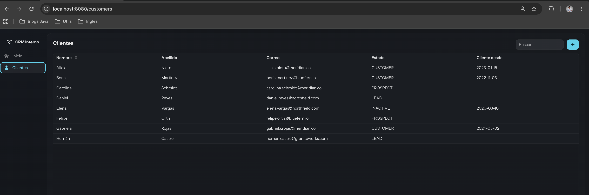
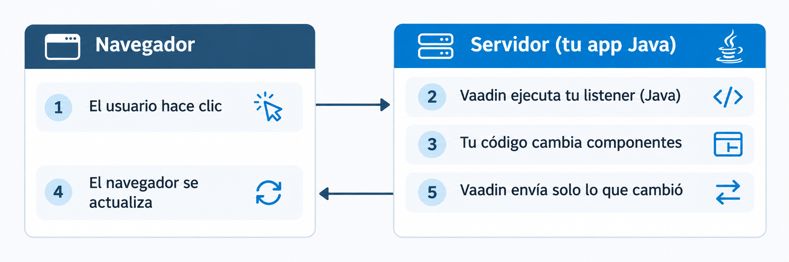

<div align="center">

# CRM interno en Java puro con Vaadin Flow

**Un CRM completo en 70 minutos, sin escribir una sola línea de JavaScript.**

[](https://openjdk.org/)
[](https://spring.io/projects/spring-boot)
[](https://vaadin.com/flow)
[](https://squidfunk.github.io/mkdocs-material/)
[](https://github.com/geovannymcode/crm-vaadin-baqjug/actions/workflows/main.yml)

[**📖 Leer la guía**](https://geovannymcode.github.io/crm-vaadin-baqjug/) ·
[**🚀 Empezar por la Sesión 0**](https://geovannymcode.github.io/crm-vaadin-baqjug/sesion_0/) ·
[**☕ Barranquilla JUG**](https://github.com/geovannymcode)

</div>



## ¿De qué va esto?

Un equipo comercial lleva sus clientes en hojas de cálculo. Cada quien
tiene su copia y nadie sabe cuál es la buena.

En este taller construimos la herramienta que lo resuelve: un CRM donde
se ven, buscan, crean, editan y eliminan clientes, con base de datos
real, menú de navegación y tema propio.

Lo interesante es **cómo**: toda la interfaz se escribe en Java, en el
mismo proyecto que el backend. No hay HTML, no hay un proyecto de
JavaScript aparte y no hay una API REST que mantener sincronizada.

## Cómo funciona Vaadin Flow



Cada botón, campo o tabla es un objeto Java que vive en el servidor.
Cuando el usuario hace clic, Vaadin ejecuta tu código y le manda al
navegador solo lo que cambió. Tú programas en Java; Vaadin se encarga
del resto.

## La ruta del taller

| # | Sesión | Lo que aprendes | ⏱️ |
|---|--------|-----------------|----|
| 0 | [Preparación y apertura](https://geovannymcode.github.io/crm-vaadin-baqjug/sesion_0/) | Proyecto en start.vaadin.com, entidad JPA, repositorio, servicio, H2 | 3 min |
| 1 | [Primera vista](https://geovannymcode.github.io/crm-vaadin-baqjug/sesion_1/) | Componentes y layouts | 6 min |
| 2 | [Mostrar datos en un Grid](https://geovannymcode.github.io/crm-vaadin-baqjug/sesion_2/) | `Grid`, columnas, ordenamiento | 7 min |
| 3 | [Filtrar con Signals](https://geovannymcode.github.io/crm-vaadin-baqjug/sesion_3/) | Estado reactivo con `ValueSignal` y `Signal.effect` | 9 min |
| 4 | [Formulario, Binder y validación](https://geovannymcode.github.io/crm-vaadin-baqjug/sesion_4/) | Formulario de detalle enlazado a la selección | 11 min |
| 5 | [Guardar, descartar, crear y eliminar](https://geovannymcode.github.io/crm-vaadin-baqjug/sesion_5/) | El CRUD completo, con confirmación | 12 min |
| 6 | [Conectar la base de datos real](https://geovannymcode.github.io/crm-vaadin-baqjug/sesion_6/) | La vista llama al servicio de Spring | 5 min |
| 7 | [App shell y navegación](https://geovannymcode.github.io/crm-vaadin-baqjug/sesion_7/) | Layout principal y menú lateral | 6 min |
| 8 | [Estilos, tema Aura y cierre](https://geovannymcode.github.io/crm-vaadin-baqjug/sesion_8/) | Variantes, CSS, modo oscuro y marca propia | 11 min |

> **¿Vienes de React o Angular?** La Sesión 3 pone el mismo buscador en
> los tres frameworks, lado a lado, con una tabla de equivalencias
> (`useState` / `signal()` / `ValueSignal`) y las trampas típicas de
> cada uno.

## Antes del taller

La agenda está justa, así que la **Sesión 0 se hace en casa**. Generar
el proyecto y descargar dependencias en vivo se come fácilmente 10
minutos.

Necesitas:

- **Java 25** (o 21)
- **IntelliJ IDEA** o **VS Code**, con el plugin de Vaadin para tener *hotswap*
- Un navegador moderno

Maven no hace falta: el proyecto trae su propio `mvnw`.

El código de la app no está en este repo. Cada asistente genera su
proyecto en [start.vaadin.com](https://start.vaadin.com) y lo construye
sesión por sesión, con un commit al cierre de cada una para poder volver
atrás si algo se rompe.

## Stack

| | |
|---|---|
| Lenguaje | Java 25 |
| Framework | Spring Boot 4.1 |
| UI | Vaadin Flow 25.3, tema Aura, Signals |
| Datos | Spring Data JPA + H2 en memoria |
| Build | Maven (wrapper incluido) |
| Guía | MkDocs Material, publicada en GitHub Pages |

## Ver la guía en tu máquina

```bash
pip install mkdocs-material pymdown-extensions
mkdocs serve
```

Abre http://localhost:8000. Los cambios en `docs/` se recargan solos.

## Publicación

Cada push a `main` dispara el workflow
[`.github/workflows/main.yml`](.github/workflows/main.yml), que construye
el sitio con `mkdocs gh-deploy` y lo sube a la rama `gh-pages`. GitHub
Pages sirve esa rama (Settings → Pages → *Deploy from a branch* →
`gh-pages`).

## Estructura

```
docs/
├── index.md          ← portada: el problema, la agenda y las versiones
├── sesion_0.md       ← preparación (antes del taller)
├── sesion_1.md … sesion_8.md
├── referencias.md
└── images/           ← capturas por sesión
mkdocs.yml            ← configuración y menú del sitio
```

## Autor

Hecho por [Geovanny Mendoza](https://github.com/geovannymcode), Vaadin
Champion y líder de **Barranquilla JUG (BAQJUG)**, para los talleres de
la comunidad.

Si la guía te sirvió, deja una ⭐ en el repo. Si encuentras un error,
abre un *issue*.
