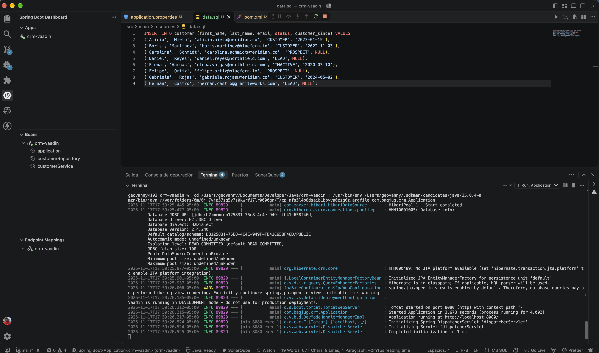

# Sesión 0: Preparación y apertura

!!! info "Resumen de la sesión"
    - **Tiempo en vivo:** 3 min (solo la apertura). Las Partes 1 a 4 se
      hacen **antes** del taller, en casa.
    - **Al terminar vas a tener:** el proyecto generado, el backend de
      clientes copiado, la base de datos con datos de ejemplo y la app
      arrancando sin errores.
    - **Conceptos nuevos:** proyecto Vaadin + Spring Boot, entidad JPA,
      repositorio, servicio, H2, *hotswap*.

---

## Parte 1: Lo que necesitas instalado

| Herramienta | Para qué | Cómo verificar |
|-------------|----------|----------------|
| **Java 25** (o 21) | Compilar y correr la app | `java -version` muestra `25` (o `21`) |
| **IntelliJ IDEA** (Community alcanza) o **VS Code** | Escribir el código | Abre sin errores |
| **Plugin de Vaadin** para tu IDE | *Hotswap*: ver cambios sin reiniciar | Aparece la opción "Debug using HotswapAgent" |
| Un navegador moderno | Ver la app | Chrome, Firefox, Edge o Safari |

=== "macOS / Linux"

    ```bash
    sdk install java 25-tem   # con SDKMAN
    ```

=== "Windows"

    ```powershell
    winget install EclipseAdoptium.Temurin.25.JDK
    ```

Maven no hace falta instalarlo: el proyecto trae su propio Maven en el
archivo `mvnw` (*Maven Wrapper*), que descarga la versión correcta la
primera vez que lo usas.

!!! note "Si usas VS Code"
    Instala dos paquetes de extensiones: **Extension Pack for Java**
    (Microsoft) y **Spring Boot Extension Pack** (VMware). El primero da
    soporte al lenguaje; el segundo agrega todo lo de Spring. Si VS Code
    no detecta tu JDK, configura `java.configuration.runtimes` en tu
    `settings.json` y ejecuta `Java: Clean Workspace`.

### ¿Qué es el *hotswap* y por qué importa?

Sin *hotswap*, cada cambio en Java implica detener el servidor, compilar
y volver a arrancar: entre 10 y 30 segundos por cambio. Con el plugin de
Vaadin, la app corre en modo depuración con una herramienta llamada
HotswapAgent: guardas el archivo, la clase se recarga dentro del servidor
que ya está corriendo, y el navegador se refresca solo.

Hay cambios que *hotswap* no puede aplicar y que obligan a reiniciar.
La guía te avisa cada vez que pase:

- crear una vista nueva con `@Route` (a veces),
- agregar parámetros al constructor de una vista,
- cambiar anotaciones de la clase `Application`.

---

## Parte 2: Generar el proyecto

### El problema

Necesitamos un proyecto Spring Boot con Vaadin, JPA y una base de datos,
y no queremos gastar tiempo del taller configurándolo a mano.

### Paso 1: Generar en start.vaadin.com

1. Entra a [start.vaadin.com](https://start.vaadin.com).
2. Elige **Flow** (no Hilla). Flow es el modo en que toda la interfaz se
   escribe en Java.
3. Java 25 (o 21) y la versión estable más reciente de Vaadin 25.x.
4. Usa `com.baqjug.crm` como paquete base (*group id*).
5. Descarga el `.zip`, descomprímelo y ábrelo en tu IDE como proyecto
   Maven.

Si el generador incluyó vistas o funcionalidades de ejemplo (por ejemplo
una lista de tareas o un `MainLayout`), **bórralas**. Vamos a construir
todo desde una vista vacía y el `MainLayout` lo creamos nosotros en la
Sesión 7.

### Paso 2: Revisar las dependencias

Abre `pom.xml` y busca estas dos dependencias. Si no están, agrégalas
dentro de `<dependencies>`:

```xml
<dependency>
    <groupId>org.springframework.boot</groupId>
    <artifactId>spring-boot-starter-data-jpa</artifactId>
</dependency>
<dependency>
    <groupId>com.h2database</groupId>
    <artifactId>h2</artifactId>
</dependency>
```

- `spring-boot-starter-data-jpa` trae **JPA** (la especificación de Java
  para guardar objetos en una base de datos relacional), **Hibernate**
  (la implementación) y **Spring Data** (que genera los repositorios por
  ti).
- `h2` es una base de datos que corre **dentro** de la misma aplicación,
  en memoria. No hay que instalar nada. A cambio, los datos se pierden al
  reiniciar: para un taller es exactamente lo que queremos.

No pongas versión: el *parent* de Spring Boot ya la define, y así todas
las dependencias quedan compatibles entre sí.

### Paso 3: La clase `Application`

Deja `src/main/java/com/baqjug/crm/Application.java` así:

```java
package com.baqjug.crm;

import com.vaadin.flow.component.dependency.StyleSheet;
import com.vaadin.flow.component.page.AppShellConfigurator;
import com.vaadin.flow.theme.aura.Aura;
import org.springframework.boot.SpringApplication;
import org.springframework.boot.autoconfigure.SpringBootApplication;

@SpringBootApplication
@StyleSheet(Aura.STYLESHEET)
@StyleSheet("styles.css")
public class Application implements AppShellConfigurator {

    public static void main(String[] args) {
        SpringApplication.run(Application.class, args);
    }
}
```

Qué hace cada línea:

| Línea | Qué hace |
|-------|----------|
| `@SpringBootApplication` | Enciende Spring Boot: busca tus clases, crea los objetos que necesitas (servicios, repositorios) y arranca un servidor web embebido. |
| `@StyleSheet(Aura.STYLESHEET)` | Carga **Aura**, el tema visual de Vaadin 25. Sin un tema, los componentes se ven sin estilo. |
| `@StyleSheet("styles.css")` | Carga nuestra propia hoja de estilos. La usamos en la Sesión 8. |
| `implements AppShellConfigurator` | Marca esta clase como la configuración global de la página (tema, estilos, esquema de color). |
| `main` | El punto de entrada. Correr `main` arranca todo: no hay un servidor aparte que instalar. |

!!! warning "Una sola clase `AppShellConfigurator`"
    Si el generador ya creó otra clase que implementa
    `AppShellConfigurator`, deja solo una. Con dos, la app no arranca y
    muestra: *"Multiple classes implementing AppShellConfigurator were
    found"*.

### Paso 4: La hoja de estilos vacía

Crea el archivo `src/main/resources/META-INF/resources/styles.css`,
vacío por ahora.

!!! warning "La ruta exacta importa"
    Vaadin sirve como archivos estáticos lo que está en
    `META-INF/resources`. Si pones `styles.css` en otra carpeta, no lo
    encuentra y **no muestra ningún error**: simplemente tus estilos no
    se aplican.

---

## Parte 3: El backend, listo de antemano

### El problema

El taller es sobre la **interfaz**. Escribir el backend en vivo nos
quitaría 10 minutos que necesitamos para la UI. Por eso se copia antes:
es Spring Data JPA estándar, y en la Sesión 6 lo conectamos a la vista.

Vamos a crear cuatro archivos en el paquete `com.baqjug.crm.backend` y
dos en `src/main/resources`.

### `Status.java`: los estados de un cliente

```java
package com.baqjug.crm.backend;

public enum Status {
    LEAD, PROSPECT, CUSTOMER, INACTIVE
}
```

Un `enum` es un tipo con un conjunto cerrado de valores. Representa en
qué etapa comercial está el cliente:

| Valor | Significado |
|-------|-------------|
| `LEAD` | Contacto inicial, todavía no calificado |
| `PROSPECT` | Interesado, en conversación |
| `CUSTOMER` | Cliente activo |
| `INACTIVE` | Fue cliente y ya no lo es |

### `Customer.java`: la entidad

```java
package com.baqjug.crm.backend;

import jakarta.persistence.*;
import java.time.LocalDate;

@Entity
@Table(name = "customer")
public class Customer {

    @Id
    @GeneratedValue(strategy = GenerationType.IDENTITY)
    private Long id;

    @Column(nullable = false)
    private String firstName = "";

    @Column(nullable = false)
    private String lastName = "";

    @Column(nullable = false)
    private String email = "";

    @Enumerated(EnumType.STRING)
    @Column(nullable = false)
    private Status status = Status.LEAD;

    private LocalDate customerSince;

    public Customer() {
    }

    public Customer(String firstName, String lastName, String email,
                    Status status, LocalDate customerSince) {
        this.firstName = firstName;
        this.lastName = lastName;
        this.email = email;
        this.status = status;
        this.customerSince = customerSince;
    }

    public Long getId() { return id; }
    public String getFirstName() { return firstName; }
    public void setFirstName(String firstName) { this.firstName = firstName; }
    public String getLastName() { return lastName; }
    public void setLastName(String lastName) { this.lastName = lastName; }
    public String getEmail() { return email; }
    public void setEmail(String email) { this.email = email; }
    public Status getStatus() { return status; }
    public void setStatus(Status status) { this.status = status; }
    public LocalDate getCustomerSince() { return customerSince; }
    public void setCustomerSince(LocalDate customerSince) { this.customerSince = customerSince; }

    @Override
    public boolean equals(Object obj) {
        if (obj == this) return true;
        if (!(obj instanceof Customer other)) return false;
        return id != null && id.equals(other.id);
    }

    @Override
    public int hashCode() {
        return getClass().hashCode();
    }
}
```

Una **entidad** es una clase Java normal que JPA sabe guardar en una
tabla. Cada objeto `Customer` es una fila de la tabla `customer`.

| Anotación | Qué hace |
|-----------|----------|
| `@Entity` | Le dice a JPA: "esta clase se guarda en la base de datos". |
| `@Table(name = "customer")` | El nombre de la tabla. |
| `@Id` | El campo que identifica cada fila (la llave primaria). |
| `@GeneratedValue(strategy = IDENTITY)` | La base de datos genera el `id` sola al insertar. Por eso un cliente nuevo tiene `id == null` hasta que se guarda: lo usamos en la Sesión 6. |
| `@Column(nullable = false)` | La columna no acepta `null`. |
| `@Enumerated(EnumType.STRING)` | Guarda el enum como texto (`"CUSTOMER"`), no como número. Si mañana reordenas el enum, los datos no se corrompen. |

Tres decisiones que vale la pena entender:

1. **Los campos de texto arrancan en `""`.** En la Sesión 5 creamos un
   cliente nuevo con `new Customer()` y lo cargamos en el formulario. Con
   cadenas vacías, los campos aparecen vacíos; con `null`, varios
   componentes fallan o muestran "null".
2. **`customerSince` no tiene valor inicial.** Un prospecto todavía no es
   cliente, así que no tiene fecha de alta. Es un campo opcional a
   propósito.
3. **`equals` compara por `id` y `hashCode` es constante.** Es el patrón
   recomendado para entidades JPA: dos objetos son "el mismo cliente" si
   tienen el mismo `id` en la base de datos. Un cliente sin `id` (nuevo)
   solo es igual a sí mismo. El `hashCode` constante evita que el objeto
   "cambie de identidad" cuando recibe su `id` al guardarse.

### `CustomerRepository.java`: el acceso a datos

```java
package com.baqjug.crm.backend;

import org.springframework.data.jpa.repository.JpaRepository;

interface CustomerRepository extends JpaRepository<Customer, Long> {
}
```

Es una interfaz **vacía**, y aun así funciona: Spring Data genera la
implementación al arrancar. Al extender `JpaRepository<Customer, Long>`
(entidad `Customer`, `id` de tipo `Long`) recibes gratis `findAll()`,
`findById(...)`, `save(...)`, `delete(...)` y muchos más.

No es `public` a propósito: solo el servicio, que está en el mismo
paquete, puede usarlo. La vista nunca habla con el repositorio.

### `CustomerService.java`: lo que la UI va a usar

```java
package com.baqjug.crm.backend;

import java.util.List;
import org.springframework.stereotype.Service;
import org.springframework.transaction.annotation.Transactional;

@Service
public class CustomerService {

    private final CustomerRepository customerRepository;

    CustomerService(CustomerRepository customerRepository) {
        this.customerRepository = customerRepository;
    }

    @Transactional(readOnly = true)
    public List<Customer> findAll() {
        return customerRepository.findAll();
    }

    @Transactional
    public Customer save(Customer customer) {
        return customerRepository.save(customer);
    }

    @Transactional
    public void delete(Customer customer) {
        customerRepository.delete(customer);
    }
}
```

| Elemento | Qué hace |
|----------|----------|
| `@Service` | Spring crea **una** instancia de esta clase y se la entrega a quien la pida en su constructor. Eso se llama **inyección de dependencias**. |
| Constructor con `CustomerRepository` | Spring ve que el servicio necesita un repositorio y se lo pasa automáticamente. |
| `@Transactional` | Cada método corre dentro de una transacción de base de datos: o se aplica todo, o nada. |
| `readOnly = true` | Le avisa a la base de datos que solo vamos a leer, lo que permite optimizar. |

`save` sirve para crear **y** para actualizar: si el cliente no tiene
`id`, hace un `INSERT`; si lo tiene, un `UPDATE`.

!!! abstract "¿Por qué un servicio, si el repositorio ya hace todo?"
    Porque el servicio es el lugar donde, más adelante, vas a poner las
    reglas de negocio ("no se puede eliminar un cliente con facturas
    pendientes", "al pasar a CUSTOMER, guardar la fecha de alta"). Si la
    vista hablara directo con el repositorio, esas reglas terminarían
    repartidas en las pantallas.

### `application.properties`

Agrega estas líneas a `src/main/resources/application.properties`:

```properties
spring.jpa.hibernate.ddl-auto=update
spring.jpa.defer-datasource-initialization=true
```

- `ddl-auto=update`: Hibernate crea (o ajusta) la tabla `customer` a
  partir de la clase `Customer`. Cómodo para aprender; en producción se
  usa una herramienta de migraciones como Flyway.
- `defer-datasource-initialization=true`: ejecuta `data.sql` **después**
  de que Hibernate cree la tabla. Sin esta línea, el script corre antes,
  la tabla no existe y la app no arranca.

### `data.sql`: datos de ejemplo

Crea `src/main/resources/data.sql`:

```sql
INSERT INTO customer (first_name, last_name, email, status, customer_since) VALUES
('Alicia', 'Nieto', 'alicia.nieto@meridian.co', 'CUSTOMER', '2023-01-15'),
('Boris', 'Martínez', 'boris.martinez@bluefern.io', 'CUSTOMER', '2022-11-03'),
('Carolina', 'Schmidt', 'carolina.schmidt@meridian.co', 'PROSPECT', NULL),
('Daniel', 'Reyes', 'daniel.reyes@northfield.com', 'LEAD', NULL),
('Elena', 'Vargas', 'elena.vargas@northfield.com', 'INACTIVE', '2020-03-10'),
('Felipe', 'Ortiz', 'felipe.ortiz@bluefern.io', 'PROSPECT', NULL),
('Gabriela', 'Rojas', 'gabriela.rojas@meridian.co', 'CUSTOMER', '2024-05-02'),
('Hernán', 'Castro', 'hernan.castro@graniteworks.com', 'LEAD', NULL);
```

Fíjate que las columnas se llaman `first_name`, `customer_since`:
Hibernate convierte `firstName` (estilo Java) a `first_name` (estilo SQL)
automáticamente.

---

## Parte 4: Comprobar que todo arranca

=== "IntelliJ IDEA"

    Abre `Application.java`, clic derecho sobre `main` →
    **Debug using HotswapAgent** (lo agrega el plugin de Vaadin).

=== "VS Code"

    Abre el panel **Spring Boot Dashboard** y usa el botón de depurar
    sobre la aplicación.

=== "Terminal"

    ```bash
    ./mvnw spring-boot:run
    ```

    En Windows: `mvnw.cmd spring-boot:run`. Así no hay *hotswap*: cada
    cambio requiere reiniciar.

La primera vez tarda varios minutos: Maven descarga las dependencias y
Vaadin prepara los recursos del navegador. Las siguientes veces arranca
en segundos.

Abre `http://localhost:8080`. Todavía no hay ninguna vista, así que
verás una página de "ruta no encontrada" o en blanco. **Eso es lo
esperado.** Lo importante está en la consola.

### Verifica

- [ ] La consola termina con un mensaje parecido a `Started Application in X seconds`.
- [ ] No hay ninguna excepción en rojo.
- [ ] En la consola aparece Hibernate creando la tabla `customer`.

### Errores comunes

| Síntoma | Causa | Solución |
|---------|-------|----------|
| `Table "CUSTOMER" not found` al arrancar | Falta `defer-datasource-initialization` | Agrega la línea en `application.properties` |
| `Multiple classes implementing AppShellConfigurator` | El generador dejó otra clase de configuración | Deja solo `Application` |
| `release version 25 not supported` | Maven usa un JDK más viejo | Configura el JDK 25 en el IDE, o baja `java.version` a 21 en el `pom.xml` |
| `Port 8080 was already in use` | Otra app usa el puerto | Cierra la otra app o agrega `server.port=8081` |

### Checkpoint

```bash
git init
git add .
git commit -m "chore: initial project with customer backend"
```

---

## Parte 5: Apertura en vivo (3 min)

1. El problema: un equipo comercial con hojas de cálculo dispersas y
   nadie con la versión real (ver la [portada](index.md)).
2. La propuesta: toda la interfaz en Java, en el mismo proyecto que el
   backend. Sin API REST, sin un segundo proyecto de JavaScript.
3. Mostrar el IDE con el proyecto abierto y la app corriendo con
   *hotswap*.



Sigue con la [Sesión 1](sesion_1.md).
