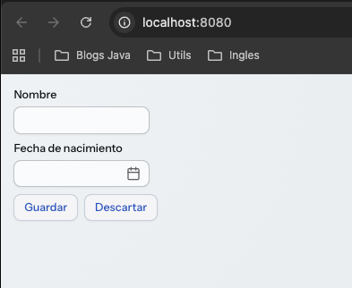

# Sesión 1: Primera vista, componentes y layouts

!!! info "Resumen de la sesión"
    - **Tiempo en vivo:** 6 min · Video de referencia: 2:29
    - **Al terminar vas a tener:** una pantalla en `http://localhost:8080`
      con un campo de texto, un selector de fecha y dos botones que
      responden al clic.
    - **Conceptos nuevos:** vista y `@Route`, componente, layout
      (`VerticalLayout`, `HorizontalLayout`), listener, `Notification`.

---

## De dónde partimos

El proyecto de la Sesión 0 arranca, pero en `http://localhost:8080` no
hay nada: todavía no existe ninguna pantalla.

## El problema

Necesitamos una primera pantalla con campos y botones. En un stack
tradicional eso implica HTML para la estructura, CSS para el aspecto,
JavaScript para reaccionar al clic y un endpoint en el backend para
recibir los datos. Queremos hacerlo todo en Java.

---

## Conceptos antes de escribir código

### ¿Qué es una vista?

Una **vista** es una pantalla de la aplicación a la que el usuario puede
llegar con una URL. En Vaadin es una clase Java con la anotación
`@Route`.

### ¿Qué es un componente?

Cada elemento de la pantalla (botón, campo de texto, tabla) es un
**componente**, y cada componente es una **clase Java**. Si necesitas un
botón, escribes `new Button("Guardar")`, igual que crearías cualquier
otro objeto.

### ¿Qué es un layout?

Un **layout** es un componente que contiene y ordena otros componentes:

| Layout | Cómo ordena |
|--------|-------------|
| `VerticalLayout` | Uno debajo del otro |
| `HorizontalLayout` | Uno al lado del otro |
| `FormLayout` | En columnas, adaptándose al ancho (lo usamos en la Sesión 4) |

Las pantallas se arman **metiendo layouts dentro de layouts**. Es la
idea central de esta sesión.

### ¿Dónde corre el código?

Esta es la diferencia más importante con un frontend tradicional:

```
Navegador                          Servidor (tu app Java)
─────────                          ──────────────────────
1. El usuario hace clic   ───────▶ 2. Vaadin ejecuta tu listener (Java)
                                   3. Tu código cambia componentes
4. El navegador se        ◀─────── 5. Vaadin envía solo lo que cambió
   actualiza
```

Tu código Java **nunca** corre en el navegador. Vaadin mantiene la
comunicación y sincroniza la pantalla. Por eso no escribes JavaScript ni
expones endpoints.

---

## Paso 1: Crear la vista vacía

Crea `src/main/java/com/baqjug/crm/ui/HomeView.java`:

```java
package com.baqjug.crm.ui;

import com.vaadin.flow.component.orderedlayout.VerticalLayout;
import com.vaadin.flow.router.Route;

@Route("")
public class HomeView extends VerticalLayout {

    public HomeView() {
    }
}
```

- `@Route("")` publica esta clase en la raíz: `http://localhost:8080`.
  Con `@Route("hola")` estaría en `http://localhost:8080/hola`.
- `extends VerticalLayout` hace que la propia vista sea un layout
  vertical: todo lo que agreguemos se apila hacia abajo.
- El constructor es donde armamos la pantalla.

**Guarda y mira:** la página ya no da error de ruta. Está vacía, pero
existe.

!!! warning "Si la ruta no aparece"
    Las vistas nuevas a veces no se registran con *hotswap*. Reinicia la
    aplicación una vez.

## Paso 2: Un campo de texto

```java
var name = new TextField("Nombre");
add(name);
```

Import: `com.vaadin.flow.component.textfield.TextField`.

- `new TextField("Nombre")` crea el campo. El texto es la etiqueta que
  se ve arriba.
- `add(...)` viene de `VerticalLayout`: agrega el componente a la
  pantalla.

**Guarda y mira:** aparece el campo. Ya puedes escribir en él.

## Paso 3: Un selector de fecha

```java
var birthDate = new DatePicker("Fecha de nacimiento");
add(name, birthDate);
```

Import: `com.vaadin.flow.component.datepicker.DatePicker`.

**Guarda y mira:** al hacer clic se abre un calendario completo. No
escribimos nada para eso: el componente ya lo trae.

## Paso 4: Un botón que no hace nada

```java
var save = new Button("Guardar");
add(name, birthDate, save);
```

Import: `com.vaadin.flow.component.button.Button`.

**Guarda y mira:** el botón aparece, pero al hacer clic no pasa nada. Un
botón sin listener es solo decoración.

## Paso 5: Reaccionar al clic

```java
save.addClickListener(e -> Notification.show("Guardado"));
```

Import: `com.vaadin.flow.component.notification.Notification`.

- `addClickListener` recibe una función (una *lambda*) que se ejecuta
  cada vez que el usuario hace clic.
- `e` es el evento del clic. Hoy no lo usamos, pero trae información
  como qué botón del mouse se usó.
- `Notification.show(...)` muestra un mensaje temporal en la esquina.

**Guarda y mira:** cada clic muestra la notificación. Ese código corrió
en el servidor.

## Paso 6: Un segundo botón

```java
var discard = new Button("Descartar");
discard.addClickListener(e -> Notification.show("Descartado"));
add(name, birthDate, save, discard);
```

**Guarda y mira:** funciona, pero los botones quedan uno debajo del otro.
En un formulario real van lado a lado.

## Paso 7: Botones lado a lado

```java
var buttons = new HorizontalLayout(save, discard);
add(name, birthDate, buttons);
```

Import: `com.vaadin.flow.component.orderedlayout.HorizontalLayout`.

Los botones ya no se agregan directo a la vista: se agregan a un
`HorizontalLayout`, y ese layout se agrega a la vista. Un layout dentro
de otro.

**Guarda y mira:** los botones quedan lado a lado.

---

## Código completo al cierre de la sesión

??? example "HomeView.java"
    ```java
    package com.baqjug.crm.ui;

    import com.vaadin.flow.component.button.Button;
    import com.vaadin.flow.component.datepicker.DatePicker;
    import com.vaadin.flow.component.notification.Notification;
    import com.vaadin.flow.component.orderedlayout.HorizontalLayout;
    import com.vaadin.flow.component.orderedlayout.VerticalLayout;
    import com.vaadin.flow.component.textfield.TextField;
    import com.vaadin.flow.router.Route;

    @Route("")
    public class HomeView extends VerticalLayout {

        public HomeView() {
            var name = new TextField("Nombre");
            var birthDate = new DatePicker("Fecha de nacimiento");

            var save = new Button("Guardar");
            save.addClickListener(e -> Notification.show("Guardado"));

            var discard = new Button("Descartar");
            discard.addClickListener(e -> Notification.show("Descartado"));

            var buttons = new HorizontalLayout(save, discard);

            add(name, birthDate, buttons);
        }
    }
    ```



---

## Verifica

- [ ] `http://localhost:8080` muestra el campo, el calendario y dos botones.
- [ ] Los botones están lado a lado.
- [ ] Cada botón muestra su propia notificación al hacer clic.

## Errores comunes

| Síntoma | Causa | Solución |
|---------|-------|----------|
| `Could not navigate to ''` | La vista nueva no se registró | Reinicia la app |
| `TextField` no compila o no tiene etiqueta | Importaste otro `TextField` (por ejemplo de AWT o Swing) | Usa `com.vaadin.flow.component.textfield.TextField` |
| Un componente no aparece | Lo creaste pero no lo agregaste con `add(...)` | Agrégalo a la vista o a un layout que esté en la vista |
| El cambio no se ve | *Hotswap* no está activo | Corre la app con "Debug using HotswapAgent" o reinicia |

## Qué resolvimos

- **Una pantalla sin HTML ni JavaScript.** `@Route` publica la vista;
  los componentes son objetos Java.
- **Los layouts organizan.** Vertical, horizontal, y layouts dentro de
  layouts: así se arma cualquier interfaz en Vaadin.
- **Los listeners corren en el servidor.** El clic viaja al servidor, tu
  Java se ejecuta ahí y Vaadin actualiza el navegador.

## Checkpoint

```bash
git add . && git commit -m "feat: first view with components and layouts"
```

Sigue con la [Sesión 2](sesion_2.md).
