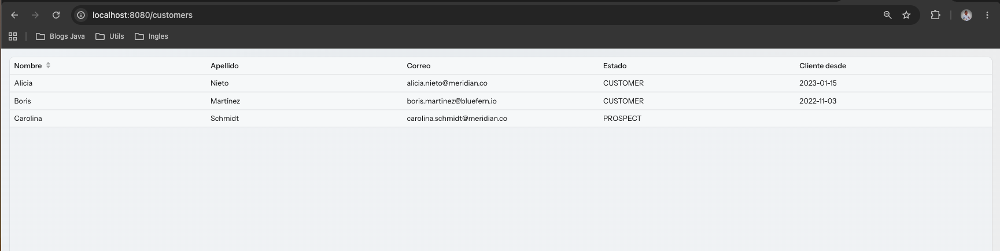

# Sesión 2: Mostrar datos en un Grid

!!! info "Resumen de la sesión"
    - **Al terminar vas a tener:** una pantalla en `/customers` con una
      tabla de clientes que ocupa toda la pantalla y se puede ordenar
      por cualquier columna.
    - **Conceptos nuevos:** `Grid`, columnas con referencias a métodos,
      `setItems`, tamaño de componentes (`setSizeFull`), ordenamiento.

---

## De dónde partimos

Tenemos `HomeView` en la raíz con componentes sueltos. El backend de la
Sesión 0 existe pero todavía no lo usamos.

## El problema

Un CRM es, antes que nada, una **lista de clientes**. Necesitamos una
tabla en su propia pantalla, que se pueda ordenar. Y queremos construir
la interfaz primero, sin depender todavía de la base de datos.

---

## Conceptos antes de escribir código

### El componente `Grid`

`Grid` es la tabla de Vaadin. Es uno de sus componentes más completos:
ordena, permite seleccionar filas, redimensionar columnas, y solo envía
al navegador las filas que se ven en pantalla, así que funciona igual
con 10 que con 100.000 filas.

Es un tipo genérico: `Grid<Customer>` es una tabla donde **cada fila es
un objeto `Customer`**.

### ¿Qué es una referencia a método?

`Customer::getFirstName` es una forma corta de escribir
`customer -> customer.getFirstName()`. Le dice al Grid: "para llenar
esta columna, llama a `getFirstName()` sobre el cliente de cada fila".

---

## Paso 1: La vista con el Grid automático

Crea `src/main/java/com/baqjug/crm/ui/CustomerListView.java`:

```java
package com.baqjug.crm.ui;

import com.baqjug.crm.backend.Customer;
import com.baqjug.crm.backend.Status;
import com.vaadin.flow.component.grid.Grid;
import com.vaadin.flow.component.orderedlayout.VerticalLayout;
import com.vaadin.flow.router.Route;
import java.time.LocalDate;
import java.util.ArrayList;
import java.util.List;

@Route("customers")
public class CustomerListView extends VerticalLayout {

    public CustomerListView() {
        var grid = new Grid<>(Customer.class);
        grid.setItems(getSampleCustomers());
        add(grid);
    }

    private List<Customer> getSampleCustomers() {
        return new ArrayList<>(List.of(
                new Customer("Alicia", "Nieto", "alicia.nieto@meridian.co",
                        Status.CUSTOMER, LocalDate.of(2023, 1, 15)),
                new Customer("Boris", "Martínez", "boris.martinez@bluefern.io",
                        Status.CUSTOMER, LocalDate.of(2022, 11, 3)),
                new Customer("Carolina", "Schmidt", "carolina.schmidt@meridian.co",
                        Status.PROSPECT, null)
        ));
    }
}
```

- `@Route("customers")`: la pantalla vive en `http://localhost:8080/customers`.
- `new Grid<>(Customer.class)`: al pasarle la clase, el Grid **genera
  una columna por cada propiedad** de `Customer`.
- `grid.setItems(...)`: le entrega la lista de filas a mostrar.
- `getSampleCustomers()` devuelve datos fijos. Usamos `new ArrayList<>(...)`
  porque `List.of(...)` es inmutable, y en la Sesión 5 vamos a agregar y
  quitar clientes de esta lista.

**Guarda, reinicia si hace falta, y abre `/customers`.** Aparece una
tabla, pero:

- tiene una columna `Id` que al usuario no le importa,
- el orden de las columnas no lo elegimos,
- los títulos son los nombres de las propiedades en inglés.

Para un prototipo sirve; para una aplicación real, no.

## Paso 2: Columnas manuales

Cambia la creación del Grid para que **no** genere columnas, y agrégalas
una por una:

```java
var grid = new Grid<Customer>();
grid.addColumn(Customer::getFirstName).setHeader("Nombre");
grid.addColumn(Customer::getLastName).setHeader("Apellido");
grid.addColumn(Customer::getEmail).setHeader("Correo");
grid.addColumn(Customer::getStatus).setHeader("Estado");
grid.addColumn(Customer::getCustomerSince).setHeader("Cliente desde");
grid.setItems(getSampleCustomers());
add(grid);
```

- `new Grid<Customer>()` sin la clase: cero columnas automáticas.
- `addColumn(Customer::getFirstName)` crea una columna con lo que
  devuelve ese getter.
- `setHeader("Nombre")` pone el título.

**Guarda y mira:** la primera vez agrega solo la columna de nombre y
mira cómo aparece; después el resto.

!!! abstract "Por qué columnas manuales: seguridad de tipos"
    Si mañana alguien renombra `getEmail()` a `getEmailAddress()`, este
    código **deja de compilar** y te enteras de inmediato. Con columnas
    generadas a partir de nombres de texto, la columna quedaría vacía en
    producción sin ningún aviso.

## Paso 3: El Grid como campo de la clase

En las próximas sesiones varios métodos van a necesitar el Grid (para
filtrar, para saber qué fila está seleccionada). Muévelo a un campo y
saca su configuración a un método propio:

```java
private final Grid<Customer> grid = new Grid<>();

public CustomerListView() {
    configureGrid();
    grid.setItems(getSampleCustomers());
    add(grid);
}

private void configureGrid() {
    grid.addColumn(Customer::getFirstName).setHeader("Nombre");
    grid.addColumn(Customer::getLastName).setHeader("Apellido");
    grid.addColumn(Customer::getEmail).setHeader("Correo");
    grid.addColumn(Customer::getStatus).setHeader("Estado");
    grid.addColumn(Customer::getCustomerSince).setHeader("Cliente desde");
}
```

El método se llama `configureGrid` y no `createGrid` porque el Grid ya
existe (se crea en el campo); el método solo lo configura.

## Paso 4: Que ocupe toda la pantalla

Agrega al final de `configureGrid()`:

```java
grid.setSizeFull();
```

**Guarda y mira:** el Grid **no** ocupa toda la pantalla. ¿Por qué?

!!! abstract "El tamaño se hereda del padre"
    `setSizeFull()` significa "100% del ancho y 100% del alto **de mi
    contenedor**". El contenedor del Grid es la vista, y la vista, por
    defecto, solo es tan alta como su contenido. 100% de algo pequeño
    sigue siendo pequeño.

Agrega `setSizeFull()` también a la vista, al inicio del constructor:

```java
public CustomerListView() {
    setSizeFull();
    configureGrid();
    grid.setItems(getSampleCustomers());
    add(grid);
}
```

**Guarda y mira:** ahora sí ocupa toda la pantalla. Este es el error de
layout más común al empezar con Vaadin: cuando algo "no crece", revisa
que **todos** sus contenedores también tengan tamaño.

## Paso 5: Ordenar columnas

Agrega `.setSortable(true)` a cada columna:

```java
grid.addColumn(Customer::getFirstName).setHeader("Nombre").setSortable(true);
```

**Guarda y mira:** aparecen flechas en los encabezados. Clic una vez:
orden ascendente; otra vez: descendente; otra vez: sin orden. El Grid
ordena por el valor que devuelve el getter (texto alfabético, fechas
cronológicas, enums por su orden de declaración).

---

## Código completo al cierre de la sesión

??? example "CustomerListView.java"
    ```java
    package com.baqjug.crm.ui;

    import com.baqjug.crm.backend.Customer;
    import com.baqjug.crm.backend.Status;
    import com.vaadin.flow.component.grid.Grid;
    import com.vaadin.flow.component.orderedlayout.VerticalLayout;
    import com.vaadin.flow.router.Route;
    import java.time.LocalDate;
    import java.util.ArrayList;
    import java.util.List;

    @Route("customers")
    public class CustomerListView extends VerticalLayout {

        private final Grid<Customer> grid = new Grid<>();

        public CustomerListView() {
            setSizeFull();
            configureGrid();
            grid.setItems(getSampleCustomers());
            add(grid);
        }

        private void configureGrid() {
            grid.addColumn(Customer::getFirstName).setHeader("Nombre").setSortable(true);
            grid.addColumn(Customer::getLastName).setHeader("Apellido").setSortable(true);
            grid.addColumn(Customer::getEmail).setHeader("Correo").setSortable(true);
            grid.addColumn(Customer::getStatus).setHeader("Estado").setSortable(true);
            grid.addColumn(Customer::getCustomerSince).setHeader("Cliente desde").setSortable(true);
            grid.setSizeFull();
        }

        private List<Customer> getSampleCustomers() {
            return new ArrayList<>(List.of(
                    new Customer("Alicia", "Nieto", "alicia.nieto@meridian.co",
                            Status.CUSTOMER, LocalDate.of(2023, 1, 15)),
                    new Customer("Boris", "Martínez", "boris.martinez@bluefern.io",
                            Status.CUSTOMER, LocalDate.of(2022, 11, 3)),
                    new Customer("Carolina", "Schmidt", "carolina.schmidt@meridian.co",
                            Status.PROSPECT, null)
            ));
        }
    }
    ```



---

## Verifica

- [ ] `http://localhost:8080/customers` muestra tres clientes.
- [ ] Hay cinco columnas, en el orden que elegiste, con títulos en español.
- [ ] No aparece la columna `Id`.
- [ ] La tabla ocupa todo el ancho y el alto.
- [ ] Al hacer clic en un encabezado, la tabla se ordena.
- [ ] Carolina muestra "Cliente desde" vacío: es un prospecto.

## Errores comunes

| Síntoma | Causa | Solución |
|---------|-------|----------|
| `/customers` da error de ruta | La vista nueva no se registró con *hotswap* | Reinicia la app |
| Columnas duplicadas | Quedó `new Grid<>(Customer.class)` y además agregaste columnas manuales | Usa `new Grid<>()` sin la clase |
| La tabla es pequeña | Falta `setSizeFull()` en la vista o en el Grid | Pónselo a los dos |
| `UnsupportedOperationException` más adelante al agregar clientes | Devolviste `List.of(...)` sin envolverlo | Usa `new ArrayList<>(List.of(...))` |

## Qué resolvimos

- **Una tabla de datos en pocas líneas**, con ordenamiento incluido.
- **Columnas explícitas y con tipos**: decides qué se ve, en qué orden,
  y el compilador te protege si cambia el modelo.
- **El tamaño se hereda**: "tamaño completo" siempre es relativo al
  contenedor.

## Checkpoint

```bash
git add . && git commit -m "feat: customer grid with manual sortable columns"
```

Sigue con la [Sesión 3](sesion_3.md).
