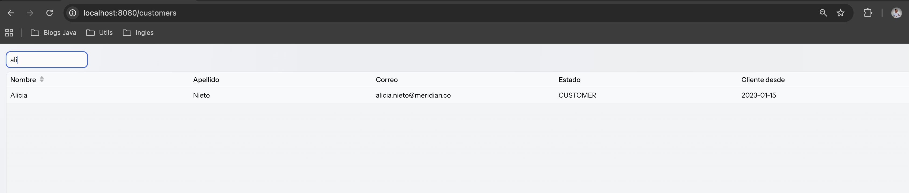

# Sesión 3: Filtrar con Signals

!!! info "Resumen de la sesión"
    - **Tiempo en vivo:** 9 min · Video de referencia: 10:36
    - **Al terminar vas a tener:** un buscador encima del Grid que filtra
      por nombre, apellido, correo y estado mientras escribes.
    - **Conceptos nuevos:** estado reactivo, `ValueSignal`, `bindValue`,
      `Signal.effect`, `get()` y `peek()`, `ValueChangeMode.LAZY`.

---

## De dónde partimos

`CustomerListView` muestra tres clientes en un Grid ordenable que ocupa
toda la pantalla.

## El problema

Con tres clientes se ve todo; con trescientos, no. Necesitamos un
buscador que filtre el Grid.

La forma "clásica" sería:

```java
search.addValueChangeListener(e -> {
    var query = e.getValue();
    grid.setItems(filter(query));
});
```

Funciona. Pero ahora imagina que, además del Grid, un contador de
resultados y un mensaje de "sin resultados" dependen de la búsqueda.
Cada uno suma su propia línea de actualización dentro del listener, y el
listener termina sabiendo de todos los componentes de la pantalla. Cada
componente nuevo obliga a tocar ese mismo código.

---

## Conceptos antes de escribir código

### Estado reactivo

En vez de escuchar un evento y actualizar la pantalla a mano, en un
modelo **reactivo** declaras una relación: "el Grid muestra los clientes
que coinciden con la búsqueda". Cuando la búsqueda cambia, el framework
se encarga de que el Grid se actualice.

### `ValueSignal`: un valor que avisa cuando cambia

Un **signal** es un contenedor de un valor. Lo especial es que sabe
quién depende de él, y cuando su valor cambia, les avisa.

```java
var searchValue = new ValueSignal<>("");   // valor inicial: texto vacío
searchValue.set("ali");                     // cambia el valor y avisa
```

### `Signal.effect`: código que se re-ejecuta solo

Un **efecto** es un bloque de código que Vaadin ejecuta una vez y vuelve
a ejecutar automáticamente cada vez que cambia algún signal que ese
bloque leyó con `get()`.

```java
Signal.effect(grid, () -> grid.setItems(filter(searchValue.get())));
```

Vaadin ve que el efecto leyó `searchValue` con `get()` y lo "suscribe":
cada `searchValue.set(...)` futuro vuelve a ejecutar el bloque.

### Si conoces React

| React | Vaadin | Diferencia |
|-------|--------|------------|
| `useState` | `ValueSignal` | En Vaadin vive en el servidor, en tu clase Java |
| `useEffect` | `Signal.effect` | Las dependencias se detectan solas con `get()`, no hay arreglo de dependencias |

!!! note "Si no te hace clic a la primera, es normal"
    La programación reactiva cuesta un par de repeticiones. En este
    taller usamos el mismo patrón (signal + enlace + efecto) cuatro veces;
    para la tercera ya se siente natural.

---

## Paso 1: La lista de clientes como campo

Hasta ahora la lista se creaba y se entregaba al Grid en una sola línea.
Para filtrarla necesitamos guardarla. Agrega el campo:

```java
private final List<Customer> customers = getSampleCustomers();
```

La lista se crea **una sola vez**, cuando se construye la vista. En la
Sesión 5 vamos a agregar y quitar clientes de esta misma lista.

## Paso 2: El signal de búsqueda

```java
private final ValueSignal<String> searchValue = new ValueSignal<>("");
```

Imports:

```java
import com.vaadin.flow.signals.Signal;
import com.vaadin.flow.signals.local.ValueSignal;
```

Es de tipo `String` porque guarda lo que el usuario escribe, y empieza
vacío: sin filtro.

## Paso 3: El campo de búsqueda, enlazado al signal

```java
private TextField createSearch() {
    var search = new TextField();
    search.bindValue(searchValue, searchValue::set);
    return search;
}
```

`bindValue` crea un **enlace de dos vías** entre el campo y el signal:

| Dirección | Qué pasa |
|-----------|----------|
| Usuario → signal | El usuario escribe y el valor se guarda con `searchValue::set` |
| Signal → campo | Si el código hace `searchValue.set("bob")`, el campo muestra "bob" |

## Paso 4: El efecto que filtra

Agrega en `createSearch()`, antes del `return`:

```java
Signal.effect(search, () -> updateCustomerList(searchValue.get()));
```

Y el método que filtra. Empezamos solo por el nombre:

```java
private void updateCustomerList(String query) {
    var filtered = customers;

    if (!query.isEmpty()) {
        var lower = query.toLowerCase();
        filtered = customers.stream()
                .filter(c -> c.getFirstName().toLowerCase().contains(lower))
                .collect(Collectors.toCollection(ArrayList::new));
    }

    grid.setItems(filtered);
}
```

Import: `java.util.stream.Collectors`.

Leámoslo por partes:

- Si la búsqueda está vacía, mostramos todos los clientes.
- Si no, pasamos todo a minúsculas (`toLowerCase()`) para que "ALI",
  "Ali" y "ali" encuentren lo mismo.
- `stream().filter(...)` deja solo los clientes cuyo nombre contiene el
  texto.
- `Collectors.toCollection(ArrayList::new)` junta el resultado en una
  lista modificable.
- Al final, `grid.setItems(...)` reemplaza las filas del Grid.

Nada de esto es específico de Vaadin: es Java normal con streams.

!!! abstract "¿Por qué `Signal.effect(search, ...)` recibe un componente?"
    El primer argumento es el **dueño** del efecto. El efecto vive
    mientras ese componente esté en pantalla: cuando el usuario navega a
    otra vista y el componente se retira, el efecto se limpia solo. No
    hay suscripciones que olvidar cerrar.

## Paso 5: Ponerlo en pantalla

```java
public CustomerListView() {
    setSizeFull();
    var search = createSearch();
    configureGrid();
    add(search, grid);
}
```

**Borra** la línea `grid.setItems(getSampleCustomers());` del
constructor.

!!! abstract "¿Por qué ya no hace falta `setItems` en el constructor?"
    Un efecto se ejecuta **una vez apenas su componente aparece en
    pantalla**, y después cada vez que cambian sus signals. En esa primera
    ejecución `searchValue` está vacío, así que `updateCustomerList("")`
    llena el Grid con todos los clientes. El efecto ya hace el trabajo.

**Guarda y mira:** escribe "ali" en el campo y presiona **Enter**. El
Grid muestra solo a Alicia.

Lo que pasó por dentro:

```
Escribes "ali" + Enter
  → bindValue guarda "ali" en searchValue
    → searchValue avisa a quien lo leyó con get()
      → el efecto se re-ejecuta: updateCustomerList("ali")
        → grid.setItems([Alicia])
```

El campo y el Grid **no se conocen**: el campo solo escribe en el
signal, y el efecto solo lee el signal.

## Paso 6: Buscar en más columnas

Amplía el filtro:

```java
filtered = customers.stream()
        .filter(c -> c.getFirstName().toLowerCase().contains(lower)
                || c.getLastName().toLowerCase().contains(lower)
                || c.getEmail().toLowerCase().contains(lower)
                || c.getStatus().name().toLowerCase().contains(lower))
        .collect(Collectors.toCollection(ArrayList::new));
```

`getStatus().name()` convierte el enum a texto (`"PROSPECT"`), así se
puede buscar por estado.

**Guarda y mira:** prueba con "bluefern" (dominio de correo), "nieto"
(apellido) y "prospect" (estado). La columna "Cliente desde" no se filtra
porque es una fecha; se podría convertir a texto, pero no lo necesitamos.

## Paso 7: Placeholder y filtro sin Enter

```java
search.setPlaceholder("Buscar");
search.setValueChangeMode(ValueChangeMode.LAZY);
```

Import: `com.vaadin.flow.data.value.ValueChangeMode`.

- `setPlaceholder` muestra un texto de ayuda dentro del campo vacío, en
  vez de una etiqueta encima.
- `ValueChangeMode` decide **cuándo** el valor del campo llega al
  servidor:

| Modo | Cuándo envía el valor | Uso típico |
|------|-----------------------|------------|
| `ON_CHANGE` (por defecto) | Al presionar Enter o salir del campo | Formularios |
| `EAGER` | En cada tecla | Casi nunca: un viaje al servidor por letra |
| `LAZY` | Cuando el usuario deja de escribir un instante | Buscadores |

**Guarda y mira:** ya no hace falta Enter. El filtro se aplica cuando
dejas de escribir.

---

## La única regla que hay que memorizar: `get()` vs `peek()`

Hay dos formas de leer un signal:

| Método | Qué hace | Dónde se usa |
|--------|----------|--------------|
| `get()` | Lee el valor **y suscribe** el efecto actual a ese signal | Dentro de `Signal.effect` |
| `peek()` | Lee el valor **sin suscribirse** | En cualquier otro lugar: listeners de botón, métodos auxiliares |

Llamar a `get()` fuera de un efecto lanza `IllegalStateException`.
Vamos a usar `peek()` por primera vez en la Sesión 5.

---

## Código completo al cierre de la sesión

??? example "CustomerListView.java"
    ```java
    package com.baqjug.crm.ui;

    import com.baqjug.crm.backend.Customer;
    import com.baqjug.crm.backend.Status;
    import com.vaadin.flow.component.grid.Grid;
    import com.vaadin.flow.component.orderedlayout.VerticalLayout;
    import com.vaadin.flow.component.textfield.TextField;
    import com.vaadin.flow.data.value.ValueChangeMode;
    import com.vaadin.flow.router.Route;
    import com.vaadin.flow.signals.Signal;
    import com.vaadin.flow.signals.local.ValueSignal;
    import java.time.LocalDate;
    import java.util.ArrayList;
    import java.util.List;
    import java.util.stream.Collectors;

    @Route("customers")
    public class CustomerListView extends VerticalLayout {

        private final Grid<Customer> grid = new Grid<>();
        private final List<Customer> customers = getSampleCustomers();
        private final ValueSignal<String> searchValue = new ValueSignal<>("");

        public CustomerListView() {
            setSizeFull();
            var search = createSearch();
            configureGrid();
            add(search, grid);
        }

        private TextField createSearch() {
            var search = new TextField();
            search.setPlaceholder("Buscar");
            search.setValueChangeMode(ValueChangeMode.LAZY);
            search.bindValue(searchValue, searchValue::set);
            Signal.effect(search, () -> updateCustomerList(searchValue.get()));
            return search;
        }

        private void configureGrid() {
            grid.addColumn(Customer::getFirstName).setHeader("Nombre").setSortable(true);
            grid.addColumn(Customer::getLastName).setHeader("Apellido").setSortable(true);
            grid.addColumn(Customer::getEmail).setHeader("Correo").setSortable(true);
            grid.addColumn(Customer::getStatus).setHeader("Estado").setSortable(true);
            grid.addColumn(Customer::getCustomerSince).setHeader("Cliente desde").setSortable(true);
            grid.setSizeFull();
        }

        private void updateCustomerList(String query) {
            var filtered = customers;

            if (!query.isEmpty()) {
                var lower = query.toLowerCase();
                filtered = customers.stream()
                        .filter(c -> c.getFirstName().toLowerCase().contains(lower)
                                || c.getLastName().toLowerCase().contains(lower)
                                || c.getEmail().toLowerCase().contains(lower)
                                || c.getStatus().name().toLowerCase().contains(lower))
                        .collect(Collectors.toCollection(ArrayList::new));
            }

            grid.setItems(filtered);
        }

        private List<Customer> getSampleCustomers() {
            return new ArrayList<>(List.of(
                    new Customer("Alicia", "Nieto", "alicia.nieto@meridian.co",
                            Status.CUSTOMER, LocalDate.of(2023, 1, 15)),
                    new Customer("Boris", "Martínez", "boris.martinez@bluefern.io",
                            Status.CUSTOMER, LocalDate.of(2022, 11, 3)),
                    new Customer("Carolina", "Schmidt", "carolina.schmidt@meridian.co",
                            Status.PROSPECT, null)
            ));
        }
    }
    ```



---

## Verifica

- [ ] Al cargar `/customers` aparecen los tres clientes (el efecto llenó el Grid).
- [ ] "ali" deja solo a Alicia; "bluefern" deja solo a Boris.
- [ ] "PROSPECT", "prospect" y "Prospect" dan el mismo resultado.
- [ ] Al borrar el texto vuelven todos.
- [ ] El filtro se aplica sin presionar Enter.

## Errores comunes

| Síntoma | Causa | Solución |
|---------|-------|----------|
| `IllegalStateException` al usar `get()` | Llamaste a `get()` fuera de un efecto | Dentro de efectos `get()`; fuera, `peek()` |
| El Grid aparece vacío al cargar | El efecto no se registró, o el Grid no está en pantalla | Revisa que `createSearch()` se llame y que `search` se agregue con `add(...)` |
| Filtra solo al presionar Enter | Falta `ValueChangeMode.LAZY` | Agrégalo al campo |
| No compila `ValueSignal` | Import equivocado o Vaadin anterior a 25.1 | `com.vaadin.flow.signals.local.ValueSignal` y Vaadin 25.1+ |

## Qué resolvimos

- **Componentes desacoplados.** El campo escribe en un signal; el efecto
  lee el signal y actualiza el Grid. Un componente nuevo que dependa de
  la búsqueda solo necesita leer el mismo signal.
- **El enlace de dos vías** (`bindValue`) mantiene campo y signal
  sincronizados en ambas direcciones.
- **Los efectos se limpian solos** porque pertenecen a un componente.
- **`LAZY`** evita un viaje al servidor por cada tecla.

## Checkpoint

```bash
git add . && git commit -m "feat: reactive search with signals"
```

Sigue con la [Sesión 4](sesion_4.md).
