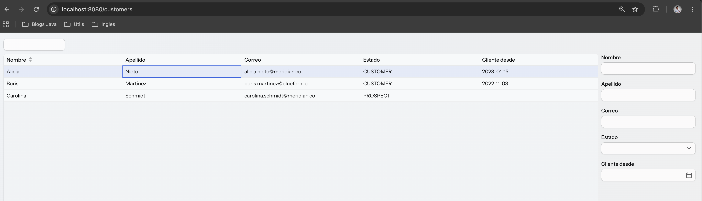
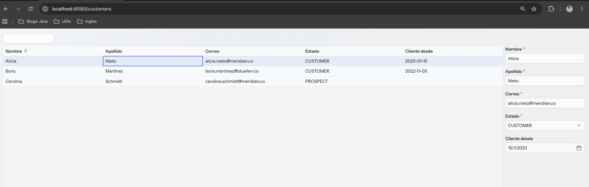

# Sesión 4: Formulario de detalle, Binder y validación

!!! info "Resumen de la sesión"
    - **Al terminar vas a tener:** al hacer clic en un cliente, un
      formulario a la derecha con sus datos; al quitar la selección, el
      formulario se oculta. Los campos obligatorios muestran error si
      quedan vacíos.
    - **Conceptos nuevos:** selección del Grid enlazada a un signal,
      `FormLayout`, `EmailField`, `ComboBox`, `map` y `bindVisible`,
      `Binder`, `asRequired`.

---

## De dónde partimos

`CustomerListView` tiene un buscador reactivo y un Grid ordenable. Se
puede ver y buscar, pero no editar.

## El problema

Queremos hacer clic en un cliente y ver sus datos en un formulario al
lado del Grid, listo para editar. Si no hay nadie seleccionado, el
formulario no debería verse.

---

## Parte 1: El formulario sigue a la selección

### Paso 1: Un signal para el cliente seleccionado

Es el mismo patrón de la búsqueda, ahora para la selección. Agrega el
campo:

```java
private final ValueSignal<Customer> editedCustomer = new ValueSignal<>(null);
```

- Si no hay nadie seleccionado, vale `null`.
- Si el usuario hace clic en Alicia, vale el objeto `Customer` de Alicia.

Lo llamamos `editedCustomer` (cliente en edición) y no `selectedCustomer`
porque en la Sesión 5 también va a contener un cliente **nuevo** que
todavía no está en el Grid.

### Paso 2: Enlazar la selección del Grid

Al final de `configureGrid()`:

```java
grid.asSingleSelect().bindValue(editedCustomer, editedCustomer::set);
```

- `asSingleSelect()` trata al Grid como un selector de **un** solo
  elemento: la fila seleccionada es su "valor".
- `bindValue` es el mismo enlace de dos vías de la Sesión 3:

| Dirección | Qué pasa |
|-----------|----------|
| Grid → signal | Clic en una fila: `editedCustomer` pasa a ser ese cliente. Clic otra vez: `null` |
| Signal → Grid | Si el código hace `editedCustomer.set(x)`, el Grid selecciona `x` |

### Paso 3: Comprobar que funciona (y borrarlo)

Un efecto temporal, para ver la selección en acción. Agrégalo en el
constructor:

```java
Signal.effect(grid, () -> Notification.show("Seleccionado: " + editedCustomer.get()));
```

Import: `com.vaadin.flow.component.notification.Notification`.

**Guarda y mira:** cada clic en una fila muestra una notificación. Nunca
llamamos a nada al hacer clic: el efecto leyó `editedCustomer` con
`get()`, así que se re-ejecuta cada vez que cambia.

Cuando lo veas funcionar, **borra** ese efecto.

### Paso 4: El formulario

```java
private FormLayout createForm() {
    var firstName = new TextField("Nombre");
    var lastName = new TextField("Apellido");
    var email = new EmailField("Correo");
    var status = new ComboBox<Status>("Estado");
    status.setItems(Status.values());
    var customerSince = new DatePicker("Cliente desde");

    var form = new FormLayout(firstName, lastName, email, status, customerSince);
    return form;
}
```

Imports:

```java
import com.vaadin.flow.component.combobox.ComboBox;
import com.vaadin.flow.component.datepicker.DatePicker;
import com.vaadin.flow.component.formlayout.FormLayout;
import com.vaadin.flow.component.textfield.EmailField;
```

Elegimos un componente distinto según el tipo de dato:

| Propiedad | Tipo en Java | Componente | Por qué |
|-----------|--------------|------------|---------|
| `firstName`, `lastName` | `String` | `TextField` | Texto libre |
| `email` | `String` | `EmailField` | Valida solo el formato de correo |
| `status` | `Status` (enum) | `ComboBox<Status>` | Desplegable con filtro; `setItems(Status.values())` ofrece los cuatro estados |
| `customerSince` | `LocalDate` | `DatePicker` | Calendario, devuelve un `LocalDate` |

`FormLayout` acomoda los campos en columnas y se adapta solo al ancho
disponible.

### Paso 5: Grid y formulario lado a lado

```java
public CustomerListView() {
    setSizeFull();
    var search = createSearch();
    configureGrid();
    var form = createForm();

    var content = new HorizontalLayout(grid, form);
    add(search, content);
}
```

Import: `com.vaadin.flow.component.orderedlayout.HorizontalLayout`.

**Guarda y mira:** dos problemas.

1. **El formulario es demasiado ancho** y aplasta al Grid. Agrega en
   `createForm()`:

    ```java
    form.setWidth("300px");
    ```

    No necesitamos que el formulario crezca: 300 px alcanzan.

2. **El Grid ya no ocupa todo el alto.** Es el mismo problema de la
   Sesión 2: el Grid ahora vive dentro de `content`, y `content` no tiene
   tamaño. Agrega:

    ```java
    content.setSizeFull();
    ```

### Paso 6: Mostrar el formulario solo si hay selección

En `createForm()`, antes del `return`:

```java
form.bindVisible(editedCustomer.map(customer -> customer != null));
```

- `editedCustomer.map(...)` crea un **signal derivado**: un
  `Signal<Boolean>` que vale `true` si hay cliente y `false` si no. Se
  recalcula solo cada vez que cambia `editedCustomer`.
- `bindVisible(...)` enlaza la visibilidad del formulario a ese
  booleano.

!!! abstract "`map` no es el `map` de un stream"
    `signal.map(f)` toma el valor actual de un signal y devuelve **otro
    signal** con el resultado de `f`, que se mantiene actualizado. No
    modifica el original y es de solo lectura. Lo vamos a usar para
    derivar visibilidad, texto y si un botón está habilitado, siempre a
    partir del mismo dato.

**Guarda y mira:** sin selección no hay formulario; al hacer clic en una
fila aparece; al hacer clic en la misma fila otra vez desaparece.

Fíjate que no solo se enlazan **valores**: también la visibilidad
(`bindVisible`), y en la Sesión 5 el texto (`bindText`) y si un botón
está habilitado (`bindEnabled`).



---

## Parte 2: Llenar el formulario con Binder

### El problema

El formulario aparece, pero **vacío**. Podríamos hacerlo a mano:

```java
firstName.setValue(customer.getFirstName());
lastName.setValue(customer.getLastName());
// ...y al guardar, al revés, campo por campo:
customer.setFirstName(firstName.getValue());
// ...y además validar cada uno
```

Con cinco campos ya son quince líneas repetitivas, y todavía falta la
validación. Con veinte campos se vuelve inmanejable.

### Concepto: ¿qué es el `Binder`?

`Binder` es un **traductor entre un formulario y un objeto Java**. Le
dices una vez qué campo corresponde a qué propiedad (con su getter y su
setter), y él se encarga de:

- **leer**: copiar los valores del objeto a los campos,
- **escribir**: copiar los valores de los campos al objeto,
- **validar**: comprobar cada campo antes de escribir.

!!! abstract "Signals y Binder no compiten"
    **Signals** decide **qué se muestra y cuándo** (qué cliente está en
    edición, si el formulario se ve). **Binder** decide **cómo se leen y
    escriben** los campos contra un objeto, con validación. Un efecto les
    sirve de puente.

### Paso 7: Crear el Binder

Agrega el campo:

```java
private final Binder<Customer> binder = new Binder<>();
```

Import: `com.vaadin.flow.data.binder.Binder`.

### Paso 8: Enlazar un campo y probar

En `createForm()`, después de crear los campos:

```java
binder.bind(firstName, Customer::getFirstName, Customer::setFirstName);

Signal.effect(form, () -> binder.setBean(editedCustomer.get()));
```

- `binder.bind(campo, getter, setter)`: para mostrar usa
  `getFirstName`; cuando el usuario escribe, usa `setFirstName`.
- El efecto es el **puente**: cada vez que cambia `editedCustomer`, el
  Binder recibe ese cliente con `setBean` y llena los campos. Usa `get()`
  porque está dentro de un efecto.

**Guarda y mira:** al hacer clic en distintas filas, el campo Nombre se
llena con el nombre de cada cliente.

!!! tip "`setBean(null)` limpia el formulario"
    Cuando no hay selección, `editedCustomer.get()` es `null` y
    `binder.setBean(null)` deja los campos vacíos. No hace falta un `if`.

### Paso 9: El resto de los campos, con validación

Reemplaza el `binder.bind(firstName, ...)` por la versión completa:

```java
binder.forField(firstName)
        .asRequired("El nombre es obligatorio")
        .bind(Customer::getFirstName, Customer::setFirstName);

binder.forField(lastName)
        .asRequired("El apellido es obligatorio")
        .bind(Customer::getLastName, Customer::setLastName);

binder.forField(email)
        .asRequired("El correo es obligatorio")
        .bind(Customer::getEmail, Customer::setEmail);

binder.forField(status)
        .asRequired("Selecciona un estado")
        .bind(Customer::getStatus, Customer::setStatus);

binder.bind(customerSince, Customer::getCustomerSince, Customer::setCustomerSince);
```

`bind(...)` directo es la forma corta. Cuando necesitas configurar algo
más (validación, conversión), usas la forma larga:

| Paso de la cadena | Qué hace |
|-------------------|----------|
| `forField(campo)` | Empieza a configurar ese campo |
| `.asRequired("mensaje")` | Lo marca obligatorio: muestra un asterisco, y si queda vacío muestra el mensaje y **no** escribe el valor en el objeto |
| `.bind(getter, setter)` | Termina la configuración y conecta el campo con la propiedad |

`customerSince` usa la forma corta y **no** es obligatorio a propósito:
un prospecto todavía no tiene fecha de alta.

**Guarda y mira:**

1. Los campos obligatorios muestran un asterisco.
2. Selecciona a Alicia y borra su nombre: el campo se marca en rojo y
   aparece "El nombre es obligatorio".
3. Escribe un correo sin `@`: `EmailField` también lo marca inválido.

!!! warning "Por ahora los cambios se aplican solos"
    Con `setBean`, cada cambio válido se escribe **de inmediato** en el
    cliente. Si cambias el nombre de Alicia y seleccionas otra fila, el
    Grid ya muestra el nombre nuevo. Ese es justamente el problema que
    resolvemos en la Sesión 5.

??? tip "Para profundizar: validadores propios"
    Antes de escribir uno, revisa los que Vaadin ya trae:
    `EmailValidator`, `StringLengthValidator`, `RegexpValidator`,
    `IntegerRangeValidator`, entre otros. Un validador propio es una
    función que devuelve `ValidationResult`:

    ```java
    import com.vaadin.flow.data.binder.ValidationResult;

    binder.forField(lastName)
            .asRequired("El apellido es obligatorio")
            .withValidator((value, context) -> value.length() >= 2
                    ? ValidationResult.ok()
                    : ValidationResult.error("Mínimo 2 caracteres"))
            .bind(Customer::getLastName, Customer::setLastName);
    ```

    `withValidator` va **antes** de `bind`. Puedes encadenar varios.



---

## Código completo al cierre de la sesión

??? example "CustomerListView.java"
    ```java
    package com.baqjug.crm.ui;

    import com.baqjug.crm.backend.Customer;
    import com.baqjug.crm.backend.Status;
    import com.vaadin.flow.component.combobox.ComboBox;
    import com.vaadin.flow.component.datepicker.DatePicker;
    import com.vaadin.flow.component.formlayout.FormLayout;
    import com.vaadin.flow.component.grid.Grid;
    import com.vaadin.flow.component.orderedlayout.HorizontalLayout;
    import com.vaadin.flow.component.orderedlayout.VerticalLayout;
    import com.vaadin.flow.component.textfield.EmailField;
    import com.vaadin.flow.component.textfield.TextField;
    import com.vaadin.flow.data.binder.Binder;
    import com.vaadin.flow.data.value.ValueChangeMode;
    import com.vaadin.flow.router.Route;
    import com.vaadin.flow.signals.Signal;
    import com.vaadin.flow.signals.local.ValueSignal;
    import java.time.LocalDate;
    import java.util.ArrayList;
    import java.util.List;
    import java.util.stream.Collectors;

    @Route("customers")
    public class CustomerListView extends VerticalLayout {

        private final Grid<Customer> grid = new Grid<>();
        private final List<Customer> customers = getSampleCustomers();
        private final ValueSignal<String> searchValue = new ValueSignal<>("");
        private final ValueSignal<Customer> editedCustomer = new ValueSignal<>(null);
        private final Binder<Customer> binder = new Binder<>();

        public CustomerListView() {
            setSizeFull();
            var search = createSearch();
            configureGrid();
            var form = createForm();

            var content = new HorizontalLayout(grid, form);
            content.setSizeFull();

            add(search, content);
        }

        private TextField createSearch() {
            var search = new TextField();
            search.setPlaceholder("Buscar");
            search.setValueChangeMode(ValueChangeMode.LAZY);
            search.bindValue(searchValue, searchValue::set);
            Signal.effect(search, () -> updateCustomerList(searchValue.get()));
            return search;
        }

        private void configureGrid() {
            grid.addColumn(Customer::getFirstName).setHeader("Nombre").setSortable(true);
            grid.addColumn(Customer::getLastName).setHeader("Apellido").setSortable(true);
            grid.addColumn(Customer::getEmail).setHeader("Correo").setSortable(true);
            grid.addColumn(Customer::getStatus).setHeader("Estado").setSortable(true);
            grid.addColumn(Customer::getCustomerSince).setHeader("Cliente desde").setSortable(true);
            grid.setSizeFull();
            grid.asSingleSelect().bindValue(editedCustomer, editedCustomer::set);
        }

        private FormLayout createForm() {
            var firstName = new TextField("Nombre");
            var lastName = new TextField("Apellido");
            var email = new EmailField("Correo");
            var status = new ComboBox<Status>("Estado");
            status.setItems(Status.values());
            var customerSince = new DatePicker("Cliente desde");

            binder.forField(firstName)
                    .asRequired("El nombre es obligatorio")
                    .bind(Customer::getFirstName, Customer::setFirstName);
            binder.forField(lastName)
                    .asRequired("El apellido es obligatorio")
                    .bind(Customer::getLastName, Customer::setLastName);
            binder.forField(email)
                    .asRequired("El correo es obligatorio")
                    .bind(Customer::getEmail, Customer::setEmail);
            binder.forField(status)
                    .asRequired("Selecciona un estado")
                    .bind(Customer::getStatus, Customer::setStatus);
            binder.bind(customerSince, Customer::getCustomerSince, Customer::setCustomerSince);

            var form = new FormLayout(firstName, lastName, email, status, customerSince);
            form.setWidth("300px");
            form.bindVisible(editedCustomer.map(customer -> customer != null));
            Signal.effect(form, () -> binder.setBean(editedCustomer.get()));
            return form;
        }

        private void updateCustomerList(String query) {
            var filtered = customers;

            if (!query.isEmpty()) {
                var lower = query.toLowerCase();
                filtered = customers.stream()
                        .filter(c -> c.getFirstName().toLowerCase().contains(lower)
                                || c.getLastName().toLowerCase().contains(lower)
                                || c.getEmail().toLowerCase().contains(lower)
                                || c.getStatus().name().toLowerCase().contains(lower))
                        .collect(Collectors.toCollection(ArrayList::new));
            }

            grid.setItems(filtered);
        }

        private List<Customer> getSampleCustomers() {
            return new ArrayList<>(List.of(
                    new Customer("Alicia", "Nieto", "alicia.nieto@meridian.co",
                            Status.CUSTOMER, LocalDate.of(2023, 1, 15)),
                    new Customer("Boris", "Martínez", "boris.martinez@bluefern.io",
                            Status.CUSTOMER, LocalDate.of(2022, 11, 3)),
                    new Customer("Carolina", "Schmidt", "carolina.schmidt@meridian.co",
                            Status.PROSPECT, null)
            ));
        }
    }
    ```

---

## Verifica

- [ ] Sin selección no se ve el formulario.
- [ ] Al hacer clic en una fila aparece el formulario con los datos de ese cliente.
- [ ] Al cambiar de fila, el formulario cambia de cliente.
- [ ] Nombre, apellido, correo y estado tienen asterisco; "Cliente desde" no.
- [ ] Borrar el nombre muestra "El nombre es obligatorio".
- [ ] El Grid sigue ocupando todo el alto.

## Errores comunes

| Síntoma | Causa | Solución |
|---------|-------|----------|
| El Grid se encoge al agregar el formulario | `content` no tiene tamaño | `content.setSizeFull()` |
| El formulario ocupa media pantalla | Falta el ancho fijo | `form.setWidth("300px")` |
| El formulario no se oculta | Falta `bindVisible`, o se aplicó a otro componente | `form.bindVisible(editedCustomer.map(c -> c != null))` |
| Los campos no se llenan | Falta el efecto con `setBean`, o usa `peek()` en vez de `get()` | Dentro del efecto, `editedCustomer.get()` |
| `ComboBox` vacío | Faltó `status.setItems(Status.values())` | Agrégalo |

## Qué resolvimos

- **La selección también es un signal.** El mismo patrón de la búsqueda
  (signal + `bindValue` + efecto) ahora conecta Grid y formulario.
- **Se pueden enlazar propiedades, no solo valores.** `bindVisible` con
  un signal derivado (`map`) muestra u oculta el formulario.
- **Binder conecta formulario y objeto**, en las dos direcciones, y
  valida antes de escribir.
- **El componente correcto para cada tipo de dato** ahorra validaciones:
  `EmailField`, `ComboBox`, `DatePicker`.

## Checkpoint

```bash
git add . && git commit -m "feat: details form bound to grid selection with binder"
```

Sigue con la [Sesión 5](sesion_5.md).
