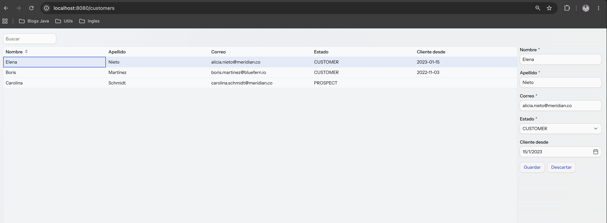
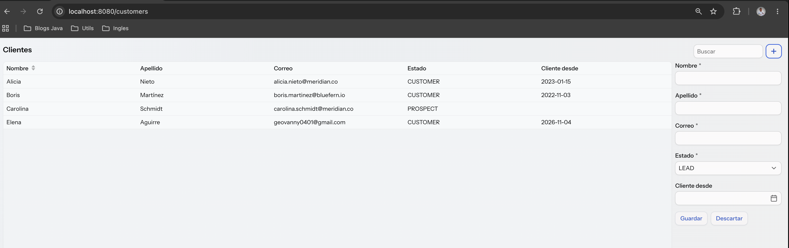
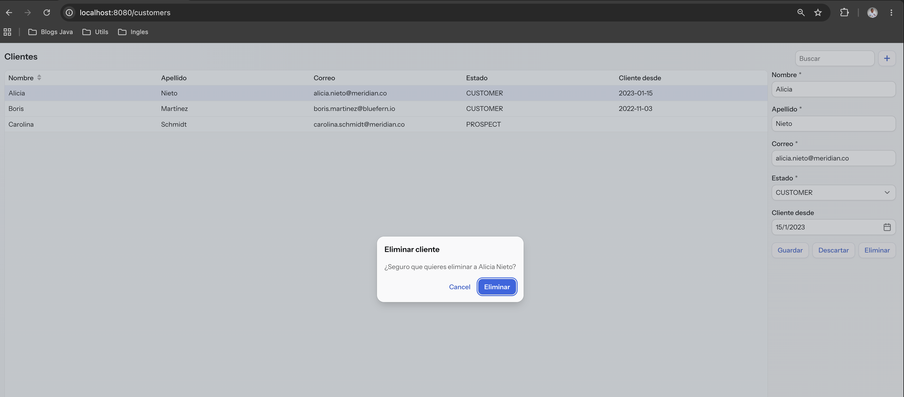

# Sesión 5: Guardar, descartar, crear y eliminar

!!! info "Resumen de la sesión"
    - **Tiempo en vivo:** 12 min · Video de referencia: 30:03
    - **Al terminar vas a tener:** un CRUD completo en memoria. Los
      cambios del formulario solo se aplican al presionar Guardar,
      Descartar los revierte, el botón + crea un cliente nuevo y Eliminar
      pide confirmación.
    - **Conceptos nuevos:** modo *write-through* vs *buffered*,
      `readBean` / `writeBean`, `ValidationException`, `peek()`, barra de
      herramientas con `setFlexGrow`, `ConfirmDialog`, `bindEnabled`.

---

## De dónde partimos

Al seleccionar un cliente, el formulario se llena con sus datos y valida
los campos obligatorios. El Binder usa `setBean`.

---

## Parte 1: Guardar y descartar

### El problema

Haz esta prueba con el código de la Sesión 4:

1. Selecciona a Alicia.
2. Cambia su nombre a "Alicia María".
3. Haz clic en otra fila.

El Grid ya muestra "Alicia María". **Nadie presionó Guardar** y el cambio
ya está aplicado. Si el usuario se equivocó, no hay forma de deshacerlo.

### Concepto: dos modos del Binder

| Modo | Cómo se activa | Qué pasa al escribir en un campo |
|------|----------------|----------------------------------|
| **Write-through** | `binder.setBean(cliente)` | Cada cambio válido se escribe **de inmediato** en el objeto |
| **Buffered** | `binder.readBean(cliente)` | Los cambios se quedan **en el formulario**. El objeto no se toca hasta llamar a `writeBean` |

*Buffer* significa "zona de espera". En un formulario real casi siempre
quieres el modo buffered: el usuario decide cuándo confirmar.

| Método | Dirección | Qué hace |
|--------|-----------|----------|
| `readBean(cliente)` | objeto → formulario | Copia los valores al formulario. No guarda referencia para escribir |
| `writeBean(cliente)` | formulario → objeto | Valida todo; si está bien, copia los valores al objeto. Si no, lanza `ValidationException` y no escribe **nada** |

### Paso 1: Cambiar a modo buffered

En `createForm()`, cambia una sola palabra en el efecto:

```java
Signal.effect(form, () -> binder.readBean(editedCustomer.get()));
```

**Guarda y mira:** el formulario se sigue llenando al seleccionar. Pero
ahora, si cambias el nombre y seleccionas otra fila, el cambio **se
pierde**: nunca llegó al objeto. Falta el botón que lo confirme.

### Paso 2: Los botones

En `createForm()`, después de enlazar los campos:

```java
var saveBtn = new Button("Guardar");
saveBtn.addClickListener(e -> save());

var discardBtn = new Button("Descartar");
discardBtn.addClickListener(e -> binder.readBean(editedCustomer.peek()));

var buttons = new HorizontalLayout(saveBtn, discardBtn);
```

Y agrega `buttons` al formulario:

```java
var form = new FormLayout(firstName, lastName, email, status, customerSince, buttons);
```

Import: `com.vaadin.flow.component.button.Button`.

**Descartar** es simplemente volver a leer el cliente: como el objeto no
se tocó, `readBean` restaura los valores originales y las ediciones
desaparecen.

!!! abstract "Por qué `peek()` y no `get()` en el listener"
    `get()` suscribe el código actual al signal, y solo tiene sentido
    dentro de un efecto, que debe re-ejecutarse cuando el signal cambia.
    Un listener de botón se ejecuta **cuando el usuario hace clic**, no
    cuando cambia el signal; solo necesita el valor en ese instante. Por
    eso usa `peek()`. Usar `get()` aquí lanza `IllegalStateException`.
    Confundirlos es el error más común con Signals.

### Paso 3: El método `save()`

```java
private void save() {
    try {
        binder.writeBean(editedCustomer.peek());
        updateCustomerList();
    } catch (ValidationException ex) {
        // The fields already show their own error messages.
    }
}

private void updateCustomerList() {
    updateCustomerList(searchValue.peek());
}
```

Import: `com.vaadin.flow.data.binder.ValidationException`.

Qué hace, paso a paso:

1. `editedCustomer.peek()`: el cliente que se está editando.
2. `writeBean(...)`: valida. Si todo está bien, copia los valores del
   formulario al cliente.
3. `updateCustomerList()`: vuelve a cargar el Grid para que muestre el
   cambio. Es una **sobrecarga** sin parámetros que reutiliza el texto
   de búsqueda actual (`searchValue.peek()`): si estabas filtrando por
   "ali", el filtro se mantiene después de guardar.

!!! warning "El `catch` vacío es intencional"
    Si `writeBean` falla, cada campo inválido **ya muestra su mensaje**.
    No hay nada que agregar. No lances una `RuntimeException` ahí:
    rompería la pantalla por un error que el usuario ya está viendo y
    puede corregir.

**Guarda y prueba:**

1. Cambia el nombre de Alicia y presiona **Descartar**: vuelve a
   "Alicia".
2. Cámbialo otra vez y presiona **Guardar**: el Grid muestra el nombre
   nuevo.
3. Borra el nombre y presiona **Guardar**: aparece el error y no se
   guarda nada.



---

## Parte 2: Barra de herramientas y alta de clientes

### El problema

Podemos editar, pero **no crear**: no hay forma de abrir el formulario
vacío. Y el buscador está solo arriba, sin título.

### Paso 4: Convertir el buscador en una barra de herramientas

Renombra `createSearch()` a `createToolbar()` y haz que devuelva una
barra con título, buscador y botón:

```java
private HorizontalLayout createToolbar() {
    var title = new H3("Clientes");

    var search = new TextField();
    search.setPlaceholder("Buscar");
    search.setValueChangeMode(ValueChangeMode.LAZY);
    search.bindValue(searchValue, searchValue::set);
    Signal.effect(search, () -> updateCustomerList(searchValue.get()));

    var addBtn = new Button(VaadinIcon.PLUS.create());
    addBtn.addClickListener(e -> addCustomer());

    var toolbar = new HorizontalLayout(title, search, addBtn);
    toolbar.setWidthFull();
    toolbar.setFlexGrow(1, title);
    return toolbar;
}
```

Imports:

```java
import com.vaadin.flow.component.html.H3;
import com.vaadin.flow.component.icon.VaadinIcon;
```

- `H3` es un título de nivel 3, como `<h3>` en HTML, pero creado en Java.
- `VaadinIcon.PLUS.create()` crea un ícono "+". Vaadin trae cientos de
  íconos listos. Un botón con solo un ícono ocupa menos espacio que uno
  que diga "Agregar cliente".
- `setWidthFull()`: la barra ocupa todo el ancho.
- `setFlexGrow(1, title)`: el título **absorbe el espacio sobrante**,
  así que empuja el buscador y el botón al borde derecho.

Actualiza el constructor:

```java
public CustomerListView() {
    setSizeFull();
    var toolbar = createToolbar();
    configureGrid();
    var form = createForm();

    var content = new HorizontalLayout(grid, form);
    content.setSizeFull();

    add(toolbar, content);
}
```

### Paso 5: Crear un cliente

```java
private void addCustomer() {
    editedCustomer.set(new Customer());
}
```

Una línea. ¿Por qué alcanza?

- El formulario es visible cuando `editedCustomer` no es `null`
  (`bindVisible`, Sesión 4) → **se abre**.
- El efecto del Binder lee `editedCustomer` → **carga los campos vacíos**
  del cliente nuevo.

No hace falta una bandera de "modo creación": el formulario ya reacciona
a lo que haya en el signal.

**Guarda y mira:** el botón + abre el formulario vacío.

### Paso 6: Guardar un cliente nuevo

Si llenas el formulario y presionas Guardar, `writeBean` escribe en el
cliente nuevo... pero ese cliente no está en la lista `customers`, así
que nunca aparece en el Grid. Ajusta `save()`:

```java
private void save() {
    try {
        var customer = editedCustomer.peek();
        binder.writeBean(customer);
        if (!customers.contains(customer)) {
            customers.add(customer);
        }
        updateCustomerList();
    } catch (ValidationException ex) {
        // The fields already show their own error messages.
    }
}
```

`contains` usa el `equals` de `Customer`. Como el cliente nuevo no tiene
`id`, solo es igual a sí mismo, así que no está en la lista y se agrega.

!!! note "Esto es temporal"
    En la Sesión 6, la base de datos decide si es un alta o una
    modificación, y este `if` desaparece.

**Guarda y prueba:** presiona +, completa los datos, Guardar. El cliente
nuevo aparece en el Grid.



---

## Parte 3: Eliminar con confirmación

### El problema

Falta la D de CRUD (*Create, Read, Update, Delete*). Y eliminar es
**destructivo**: un clic por error no debería borrar un cliente sin
preguntar.

### Paso 7: El botón Eliminar

En `createForm()`:

```java
var deleteBtn = new Button("Eliminar");
deleteBtn.addClickListener(e -> confirmDelete());
deleteBtn.bindEnabled(editedCustomer.map(customer -> customer != null));

var buttons = new HorizontalLayout(saveBtn, discardBtn, deleteBtn);
```

`bindEnabled` es la misma idea que `bindVisible`: el botón está
habilitado solo si hay un cliente en edición.

### Paso 8: El diálogo de confirmación

Constrúyelo de a poco, guardando entre pasos:

```java
private void confirmDelete() {
    var customer = editedCustomer.peek();

    var dialog = new ConfirmDialog();
    dialog.setHeader("Eliminar cliente");
    dialog.setText("¿Seguro que quieres eliminar a %s %s?"
            .formatted(customer.getFirstName(), customer.getLastName()));
    dialog.setCancelable(true);
    dialog.setConfirmText("Eliminar");
    dialog.addConfirmListener(e -> {
        customers.remove(customer);
        updateCustomerList();
    });
    dialog.open();
}
```

Import: `com.vaadin.flow.component.confirmdialog.ConfirmDialog`.

| Línea | Qué hace |
|-------|----------|
| `new ConfirmDialog()` | Crea el diálogo. Todavía no se ve |
| `setHeader(...)` | Título del diálogo |
| `setText(...)` | El mensaje. `formatted` reemplaza cada `%s` por el nombre y el apellido |
| `setCancelable(true)` | Agrega el botón Cancelar. Sin esto, solo hay botón de confirmar |
| `setConfirmText("Eliminar")` | El texto del botón de confirmar. Más claro que un "Confirmar" genérico |
| `addConfirmListener(...)` | Lo que pasa **solo si** el usuario confirma |
| `open()` | Muestra el diálogo |

Fíjate que `customer` se lee con `peek()` **una vez**, al principio, y se
usa en el texto y en el listener. Así el diálogo elimina exactamente al
cliente que nombra.

**Guarda y prueba:** selecciona a Carolina, Eliminar, Cancelar: no pasa
nada. Eliminar otra vez, confirmar: desaparece del Grid.



---

## Código completo al cierre de la sesión

??? example "CustomerListView.java"
    ```java
    package com.baqjug.crm.ui;

    import com.baqjug.crm.backend.Customer;
    import com.baqjug.crm.backend.Status;
    import com.vaadin.flow.component.button.Button;
    import com.vaadin.flow.component.combobox.ComboBox;
    import com.vaadin.flow.component.confirmdialog.ConfirmDialog;
    import com.vaadin.flow.component.datepicker.DatePicker;
    import com.vaadin.flow.component.formlayout.FormLayout;
    import com.vaadin.flow.component.grid.Grid;
    import com.vaadin.flow.component.html.H3;
    import com.vaadin.flow.component.icon.VaadinIcon;
    import com.vaadin.flow.component.orderedlayout.HorizontalLayout;
    import com.vaadin.flow.component.orderedlayout.VerticalLayout;
    import com.vaadin.flow.component.textfield.EmailField;
    import com.vaadin.flow.component.textfield.TextField;
    import com.vaadin.flow.data.binder.Binder;
    import com.vaadin.flow.data.binder.ValidationException;
    import com.vaadin.flow.data.value.ValueChangeMode;
    import com.vaadin.flow.router.Route;
    import com.vaadin.flow.signals.Signal;
    import com.vaadin.flow.signals.local.ValueSignal;
    import java.time.LocalDate;
    import java.util.ArrayList;
    import java.util.List;
    import java.util.stream.Collectors;

    @Route("customers")
    public class CustomerListView extends VerticalLayout {

        private final Grid<Customer> grid = new Grid<>();
        private final List<Customer> customers = getSampleCustomers();
        private final ValueSignal<String> searchValue = new ValueSignal<>("");
        private final ValueSignal<Customer> editedCustomer = new ValueSignal<>(null);
        private final Binder<Customer> binder = new Binder<>();

        public CustomerListView() {
            setSizeFull();
            var toolbar = createToolbar();
            configureGrid();
            var form = createForm();

            var content = new HorizontalLayout(grid, form);
            content.setSizeFull();

            add(toolbar, content);
        }

        private HorizontalLayout createToolbar() {
            var title = new H3("Clientes");

            var search = new TextField();
            search.setPlaceholder("Buscar");
            search.setValueChangeMode(ValueChangeMode.LAZY);
            search.bindValue(searchValue, searchValue::set);
            Signal.effect(search, () -> updateCustomerList(searchValue.get()));

            var addBtn = new Button(VaadinIcon.PLUS.create());
            addBtn.addClickListener(e -> addCustomer());

            var toolbar = new HorizontalLayout(title, search, addBtn);
            toolbar.setWidthFull();
            toolbar.setFlexGrow(1, title);
            return toolbar;
        }

        private void configureGrid() {
            grid.addColumn(Customer::getFirstName).setHeader("Nombre").setSortable(true);
            grid.addColumn(Customer::getLastName).setHeader("Apellido").setSortable(true);
            grid.addColumn(Customer::getEmail).setHeader("Correo").setSortable(true);
            grid.addColumn(Customer::getStatus).setHeader("Estado").setSortable(true);
            grid.addColumn(Customer::getCustomerSince).setHeader("Cliente desde").setSortable(true);
            grid.setSizeFull();
            grid.asSingleSelect().bindValue(editedCustomer, editedCustomer::set);
        }

        private FormLayout createForm() {
            var firstName = new TextField("Nombre");
            var lastName = new TextField("Apellido");
            var email = new EmailField("Correo");
            var status = new ComboBox<Status>("Estado");
            status.setItems(Status.values());
            var customerSince = new DatePicker("Cliente desde");

            binder.forField(firstName)
                    .asRequired("El nombre es obligatorio")
                    .bind(Customer::getFirstName, Customer::setFirstName);
            binder.forField(lastName)
                    .asRequired("El apellido es obligatorio")
                    .bind(Customer::getLastName, Customer::setLastName);
            binder.forField(email)
                    .asRequired("El correo es obligatorio")
                    .bind(Customer::getEmail, Customer::setEmail);
            binder.forField(status)
                    .asRequired("Selecciona un estado")
                    .bind(Customer::getStatus, Customer::setStatus);
            binder.bind(customerSince, Customer::getCustomerSince, Customer::setCustomerSince);

            var saveBtn = new Button("Guardar");
            saveBtn.addClickListener(e -> save());

            var discardBtn = new Button("Descartar");
            discardBtn.addClickListener(e -> binder.readBean(editedCustomer.peek()));

            var deleteBtn = new Button("Eliminar");
            deleteBtn.addClickListener(e -> confirmDelete());
            deleteBtn.bindEnabled(editedCustomer.map(customer -> customer != null));

            var buttons = new HorizontalLayout(saveBtn, discardBtn, deleteBtn);

            var form = new FormLayout(firstName, lastName, email, status, customerSince, buttons);
            form.setWidth("300px");
            form.bindVisible(editedCustomer.map(customer -> customer != null));
            Signal.effect(form, () -> binder.readBean(editedCustomer.get()));
            return form;
        }

        private void addCustomer() {
            editedCustomer.set(new Customer());
        }

        private void save() {
            try {
                var customer = editedCustomer.peek();
                binder.writeBean(customer);
                if (!customers.contains(customer)) {
                    customers.add(customer);
                }
                updateCustomerList();
            } catch (ValidationException ex) {
                // The fields already show their own error messages.
            }
        }

        private void confirmDelete() {
            var customer = editedCustomer.peek();

            var dialog = new ConfirmDialog();
            dialog.setHeader("Eliminar cliente");
            dialog.setText("¿Seguro que quieres eliminar a %s %s?"
                    .formatted(customer.getFirstName(), customer.getLastName()));
            dialog.setCancelable(true);
            dialog.setConfirmText("Eliminar");
            dialog.addConfirmListener(e -> {
                customers.remove(customer);
                updateCustomerList();
            });
            dialog.open();
        }

        private void updateCustomerList() {
            updateCustomerList(searchValue.peek());
        }

        private void updateCustomerList(String query) {
            var filtered = customers;

            if (!query.isEmpty()) {
                var lower = query.toLowerCase();
                filtered = customers.stream()
                        .filter(c -> c.getFirstName().toLowerCase().contains(lower)
                                || c.getLastName().toLowerCase().contains(lower)
                                || c.getEmail().toLowerCase().contains(lower)
                                || c.getStatus().name().toLowerCase().contains(lower))
                        .collect(Collectors.toCollection(ArrayList::new));
            }

            grid.setItems(filtered);
        }

        private List<Customer> getSampleCustomers() {
            return new ArrayList<>(List.of(
                    new Customer("Alicia", "Nieto", "alicia.nieto@meridian.co",
                            Status.CUSTOMER, LocalDate.of(2023, 1, 15)),
                    new Customer("Boris", "Martínez", "boris.martinez@bluefern.io",
                            Status.CUSTOMER, LocalDate.of(2022, 11, 3)),
                    new Customer("Carolina", "Schmidt", "carolina.schmidt@meridian.co",
                            Status.PROSPECT, null)
            ));
        }
    }
    ```

---

## Verifica

- [ ] Editar y seleccionar otra fila **no** aplica el cambio.
- [ ] Descartar restaura los valores originales.
- [ ] Guardar actualiza el Grid.
- [ ] Guardar con un campo obligatorio vacío muestra el error y no guarda.
- [ ] El título "Clientes" está a la izquierda; buscador y + a la derecha.
- [ ] El + abre el formulario vacío, y al guardar el cliente aparece en el Grid.
- [ ] Eliminar abre un diálogo con el nombre del cliente; Cancelar no borra nada.
- [ ] Si filtras por "ali" y guardas, el filtro se mantiene.

## Errores comunes

| Síntoma | Causa | Solución |
|---------|-------|----------|
| `IllegalStateException` al hacer clic | Usaste `get()` dentro de un listener | Usa `peek()` |
| Los cambios se aplican sin Guardar | El efecto sigue usando `setBean` | Cámbialo a `readBean` |
| Guardar no hace nada visible | Falta `updateCustomerList()` después de `writeBean` | Agrégalo |
| El cliente nuevo no aparece en el Grid | Falta agregarlo a `customers` | El `if (!customers.contains(...))` de `save()` |
| `UnsupportedOperationException` al agregar | `getSampleCustomers()` devuelve `List.of(...)` sin envolver | `new ArrayList<>(List.of(...))` |
| El diálogo no tiene botón Cancelar | Falta `setCancelable(true)` | Agrégalo |

## Qué resolvimos

- **Modo buffered:** el usuario confirma o descarta; nada se aplica por
  accidente.
- **`peek()` en listeners, `get()` en efectos:** la regla de la Sesión 3
  en acción.
- **Crear es poner un objeto nuevo en el signal:** formulario y Binder
  ya reaccionan a él.
- **Confirmación antes de destruir** con `ConfirmDialog`.
- **`bindEnabled`:** otra propiedad enlazada a un signal derivado.

## Checkpoint

```bash
git add . && git commit -m "feat: buffered save, discard, create and delete"
```

Sigue con la [Sesión 6](sesion_6.md).
