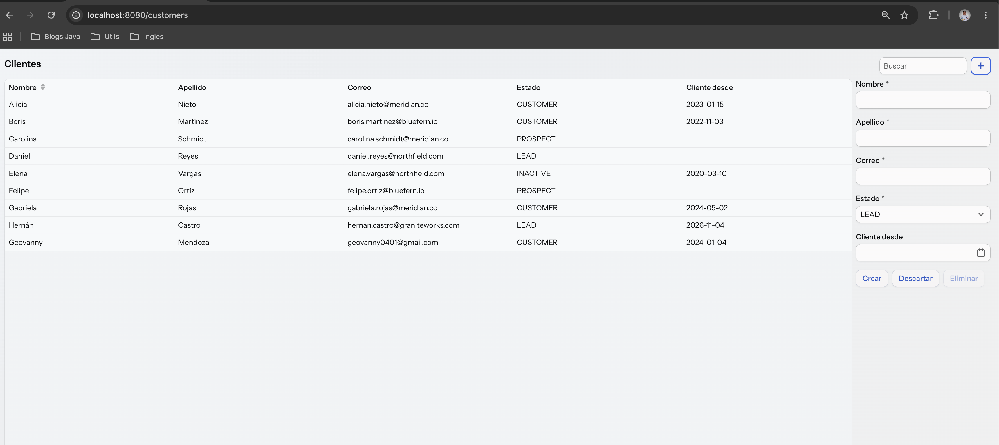

# Sesión 6: Conectar la base de datos real

!!! info "Resumen de la sesión"
    - **Tiempo en vivo:** 5 min · Video de referencia: 43:52
    - **Al terminar vas a tener:** el Grid mostrando los clientes de la
      base de datos H2, y guardar, crear y eliminar persistiendo de
      verdad. El botón dice "Crear" o "Guardar" según el caso, y Eliminar
      se deshabilita para un cliente que todavía no existe.
    - **Conceptos nuevos:** inyección de dependencias en una vista,
      llamar al servicio sin REST, distinguir nuevo vs existente por `id`,
      `bindText`.

---

## De dónde partimos

`CustomerListView` tiene un CRUD completo, pero sobre una lista en
memoria (`customers`) con tres clientes fijos.

## El problema

1. **Los cambios no sobreviven.** Todo vive en una lista dentro de la
   vista: si reinicias, o si otro usuario abre la pantalla, no ve nada de
   lo que hiciste.
2. **No sabemos si un cliente es nuevo o existente.** Mira: presiona +
   para crear un cliente. El botón Eliminar está **habilitado**, aunque
   ese cliente todavía no existe. Y el botón dice "Guardar" en los dos
   casos.

---

## Concepto: la vista llama al servicio, sin REST

En un stack tradicional, para que la pantalla lea clientes de la base de
datos necesitas:

```
Navegador ──HTTP/JSON──▶ Controlador REST ──▶ Servicio ──▶ Repositorio ──▶ BD
```

En Vaadin la vista **ya está en el servidor**, así que llama al servicio
como a cualquier objeto Java:

```
CustomerListView ──▶ CustomerService ──▶ CustomerRepository ──▶ H2
```

Sin endpoints, sin serializar a JSON, sin DTOs de transporte, sin
duplicar validaciones en dos lenguajes.

### ¿Cómo obtiene la vista el servicio?

Con **inyección de dependencias**, la misma que usa el servicio para
recibir el repositorio (Sesión 0). Las vistas de Vaadin las crea Spring,
así que basta con pedir el servicio en el constructor: Spring lo ve y lo
entrega.

---

## Paso 1: Pedir el servicio en el constructor

```java
private final CustomerService customerService;

public CustomerListView(CustomerService customerService) {
    this.customerService = customerService;

    setSizeFull();
    var toolbar = createToolbar();
    configureGrid();
    var form = createForm();

    var content = new HorizontalLayout(grid, form);
    content.setSizeFull();

    add(toolbar, content);
}
```

Import: `com.baqjug.crm.backend.CustomerService`.

!!! warning "Asigna el servicio antes de todo lo demás"
    `this.customerService = customerService;` debe ser la **primera**
    línea del constructor. Los métodos que vienen después lo usan.

## Paso 2: Borrar la lista en memoria

**Borra**:

- el campo `private final List<Customer> customers = getSampleCustomers();`
- el método `getSampleCustomers()`

El compilador marca en rojo los tres lugares que usaban `customers`. Son
exactamente los tres que hay que cambiar.

## Paso 3: Cargar desde la base de datos

```java
private void updateCustomerList(String query) {
    var filtered = customerService.findAll();

    if (!query.isEmpty()) {
        var lower = query.toLowerCase();
        filtered = filtered.stream()
                .filter(c -> c.getFirstName().toLowerCase().contains(lower)
                        || c.getLastName().toLowerCase().contains(lower)
                        || c.getEmail().toLowerCase().contains(lower)
                        || c.getStatus().name().toLowerCase().contains(lower))
                .collect(Collectors.toCollection(ArrayList::new));
    }

    grid.setItems(filtered);
}
```

Solo cambió la primera línea: los clientes vienen de
`customerService.findAll()`. El filtro sigue igual.

!!! note "Filtrar en Java o en la base de datos"
    Aquí traemos todos los clientes y filtramos en Java. Con ocho
    clientes está perfecto. Con decenas de miles convendría filtrar en
    la base de datos (un método del repositorio con `LIKE`) y paginar,
    pero eso queda fuera del taller.

## Paso 4: Guardar en la base de datos

```java
private void save() {
    try {
        var customer = editedCustomer.peek();
        binder.writeBean(customer);
        customerService.save(customer);
        updateCustomerList();
    } catch (ValidationException ex) {
        // The fields already show their own error messages.
    }
}
```

El `if (!customers.contains(...))` **desaparece**. `save` de Spring Data
decide solo:

| El cliente... | `save` hace |
|---------------|-------------|
| no tiene `id` (nuevo) | `INSERT`, y la base de datos le asigna un `id` |
| tiene `id` (existente) | `UPDATE` |

## Paso 5: Eliminar de la base de datos

En `confirmDelete()`, cambia el listener:

```java
dialog.addConfirmListener(e -> {
    customerService.delete(customer);
    updateCustomerList();
});
```

## Paso 6: Reiniciar

!!! warning "Reinicia la aplicación"
    Agregar un parámetro al constructor cambia cómo Spring construye la
    vista, y *hotswap* no puede aplicar ese cambio. Detén la app y
    vuelve a arrancarla.

**Mira:** el Grid ahora muestra los **ocho** clientes de `data.sql`.
Edita uno y guarda: el cambio persiste mientras la app esté corriendo.
Abre otra pestaña en `/customers`: también lo ve, porque los dos leen de
la misma base de datos.

---

## Paso 7: ¿Nuevo o existente?

Con una base de datos hay una regla confiable: **un cliente guardado
tiene `id`; uno nuevo, no** (la base de datos lo asigna al insertar,
por el `@GeneratedValue` de la Sesión 0).

```java
private boolean isNew(Customer customer) {
    return customer != null && customer.getId() == null;
}
```

El `customer != null` evita un `NullPointerException` cuando no hay nadie
seleccionado.

## Paso 8: El botón dice "Crear" o "Guardar"

En `createForm()`, cambia la creación del botón:

```java
var saveBtn = new Button();
saveBtn.bindText(editedCustomer.map(customer -> isNew(customer) ? "Crear" : "Guardar"));
saveBtn.addClickListener(e -> save());
```

- `new Button()` sin texto: el texto lo pone el enlace.
- `bindText(...)` enlaza el texto del botón a un signal derivado. Es la
  tercera propiedad que enlazamos, después de `bindVisible` y
  `bindEnabled`.

## Paso 9: No se puede eliminar lo que no existe

Cambia el `bindEnabled` de Eliminar:

```java
deleteBtn.bindEnabled(editedCustomer.map(customer -> !isNew(customer)));
```

**Guarda y mira:**

| Acción | Botón principal | Eliminar |
|--------|-----------------|----------|
| Clic en un cliente existente | "Guardar" | Habilitado |
| Clic en + | "Crear" | Deshabilitado |

Un solo método, `isNew`, produce dos comportamientos, los dos derivados
del mismo signal.



---

## Código completo al cierre de la sesión

??? example "CustomerListView.java"
    ```java
    package com.baqjug.crm.ui;

    import com.baqjug.crm.backend.Customer;
    import com.baqjug.crm.backend.CustomerService;
    import com.baqjug.crm.backend.Status;
    import com.vaadin.flow.component.button.Button;
    import com.vaadin.flow.component.combobox.ComboBox;
    import com.vaadin.flow.component.confirmdialog.ConfirmDialog;
    import com.vaadin.flow.component.datepicker.DatePicker;
    import com.vaadin.flow.component.formlayout.FormLayout;
    import com.vaadin.flow.component.grid.Grid;
    import com.vaadin.flow.component.html.H3;
    import com.vaadin.flow.component.icon.VaadinIcon;
    import com.vaadin.flow.component.orderedlayout.HorizontalLayout;
    import com.vaadin.flow.component.orderedlayout.VerticalLayout;
    import com.vaadin.flow.component.textfield.EmailField;
    import com.vaadin.flow.component.textfield.TextField;
    import com.vaadin.flow.data.binder.Binder;
    import com.vaadin.flow.data.binder.ValidationException;
    import com.vaadin.flow.data.value.ValueChangeMode;
    import com.vaadin.flow.router.Route;
    import com.vaadin.flow.signals.Signal;
    import com.vaadin.flow.signals.local.ValueSignal;
    import java.util.ArrayList;
    import java.util.stream.Collectors;

    @Route("customers")
    public class CustomerListView extends VerticalLayout {

        private final CustomerService customerService;

        private final Grid<Customer> grid = new Grid<>();
        private final ValueSignal<String> searchValue = new ValueSignal<>("");
        private final ValueSignal<Customer> editedCustomer = new ValueSignal<>(null);
        private final Binder<Customer> binder = new Binder<>();

        public CustomerListView(CustomerService customerService) {
            this.customerService = customerService;

            setSizeFull();
            var toolbar = createToolbar();
            configureGrid();
            var form = createForm();

            var content = new HorizontalLayout(grid, form);
            content.setSizeFull();

            add(toolbar, content);
        }

        private HorizontalLayout createToolbar() {
            var title = new H3("Clientes");

            var search = new TextField();
            search.setPlaceholder("Buscar");
            search.setValueChangeMode(ValueChangeMode.LAZY);
            search.bindValue(searchValue, searchValue::set);
            Signal.effect(search, () -> updateCustomerList(searchValue.get()));

            var addBtn = new Button(VaadinIcon.PLUS.create());
            addBtn.addClickListener(e -> addCustomer());

            var toolbar = new HorizontalLayout(title, search, addBtn);
            toolbar.setWidthFull();
            toolbar.setFlexGrow(1, title);
            return toolbar;
        }

        private void configureGrid() {
            grid.addColumn(Customer::getFirstName).setHeader("Nombre").setSortable(true);
            grid.addColumn(Customer::getLastName).setHeader("Apellido").setSortable(true);
            grid.addColumn(Customer::getEmail).setHeader("Correo").setSortable(true);
            grid.addColumn(Customer::getStatus).setHeader("Estado").setSortable(true);
            grid.addColumn(Customer::getCustomerSince).setHeader("Cliente desde").setSortable(true);
            grid.setSizeFull();
            grid.asSingleSelect().bindValue(editedCustomer, editedCustomer::set);
        }

        private FormLayout createForm() {
            var firstName = new TextField("Nombre");
            var lastName = new TextField("Apellido");
            var email = new EmailField("Correo");
            var status = new ComboBox<Status>("Estado");
            status.setItems(Status.values());
            var customerSince = new DatePicker("Cliente desde");

            binder.forField(firstName)
                    .asRequired("El nombre es obligatorio")
                    .bind(Customer::getFirstName, Customer::setFirstName);
            binder.forField(lastName)
                    .asRequired("El apellido es obligatorio")
                    .bind(Customer::getLastName, Customer::setLastName);
            binder.forField(email)
                    .asRequired("El correo es obligatorio")
                    .bind(Customer::getEmail, Customer::setEmail);
            binder.forField(status)
                    .asRequired("Selecciona un estado")
                    .bind(Customer::getStatus, Customer::setStatus);
            binder.bind(customerSince, Customer::getCustomerSince, Customer::setCustomerSince);

            var saveBtn = new Button();
            saveBtn.bindText(editedCustomer.map(customer -> isNew(customer) ? "Crear" : "Guardar"));
            saveBtn.addClickListener(e -> save());

            var discardBtn = new Button("Descartar");
            discardBtn.addClickListener(e -> binder.readBean(editedCustomer.peek()));

            var deleteBtn = new Button("Eliminar");
            deleteBtn.addClickListener(e -> confirmDelete());
            deleteBtn.bindEnabled(editedCustomer.map(customer -> !isNew(customer)));

            var buttons = new HorizontalLayout(saveBtn, discardBtn, deleteBtn);

            var form = new FormLayout(firstName, lastName, email, status, customerSince, buttons);
            form.setWidth("300px");
            form.bindVisible(editedCustomer.map(customer -> customer != null));
            Signal.effect(form, () -> binder.readBean(editedCustomer.get()));
            return form;
        }

        private boolean isNew(Customer customer) {
            return customer != null && customer.getId() == null;
        }

        private void addCustomer() {
            editedCustomer.set(new Customer());
        }

        private void save() {
            try {
                var customer = editedCustomer.peek();
                binder.writeBean(customer);
                customerService.save(customer);
                updateCustomerList();
            } catch (ValidationException ex) {
                // The fields already show their own error messages.
            }
        }

        private void confirmDelete() {
            var customer = editedCustomer.peek();

            var dialog = new ConfirmDialog();
            dialog.setHeader("Eliminar cliente");
            dialog.setText("¿Seguro que quieres eliminar a %s %s?"
                    .formatted(customer.getFirstName(), customer.getLastName()));
            dialog.setCancelable(true);
            dialog.setConfirmText("Eliminar");
            dialog.addConfirmListener(e -> {
                customerService.delete(customer);
                updateCustomerList();
            });
            dialog.open();
        }

        private void updateCustomerList() {
            updateCustomerList(searchValue.peek());
        }

        private void updateCustomerList(String query) {
            var filtered = customerService.findAll();

            if (!query.isEmpty()) {
                var lower = query.toLowerCase();
                filtered = filtered.stream()
                        .filter(c -> c.getFirstName().toLowerCase().contains(lower)
                                || c.getLastName().toLowerCase().contains(lower)
                                || c.getEmail().toLowerCase().contains(lower)
                                || c.getStatus().name().toLowerCase().contains(lower))
                        .collect(Collectors.toCollection(ArrayList::new));
            }

            grid.setItems(filtered);
        }
    }
    ```

---

## Verifica

- [ ] El Grid muestra los ocho clientes de `data.sql`.
- [ ] Editar y guardar persiste el cambio (ábrelo en otra pestaña para comprobarlo).
- [ ] Crear un cliente lo agrega a la base de datos.
- [ ] Eliminar lo quita de la base de datos.
- [ ] Con un cliente existente el botón dice "Guardar" y Eliminar está habilitado.
- [ ] Con un cliente nuevo (botón +) el botón dice "Crear" y Eliminar está deshabilitado.
- [ ] Al reiniciar la app vuelven los ocho clientes originales (H2 está en memoria).

## Errores comunes

| Síntoma | Causa | Solución |
|---------|-------|----------|
| `NullPointerException` en `customerService` | Usaste el servicio antes de asignarlo | Primera línea del constructor: `this.customerService = customerService;` |
| Los cambios del constructor no se ven | *Hotswap* no aplica cambios de constructor | Reinicia la app |
| El Grid sigue mostrando tres clientes | Quedó `getSampleCustomers()` en algún lado | Bórralo y usa `customerService.findAll()` |
| `NullPointerException` en `isNew` | Falta el `customer != null` | Usa la versión completa de `isNew` |
| El Grid aparece vacío | `data.sql` no se ejecutó | Revisa `defer-datasource-initialization` en `application.properties` (Sesión 0) |

## Qué resolvimos

- **La vista llama al servicio directamente**, como a cualquier objeto
  Java. No hay REST, ni JSON, ni DTOs de transporte.
- **Cambiar el origen de datos tocó solo tres métodos.** El Grid, los
  Signals, el Binder y los botones no se enteraron.
- **Nuevo vs existente por `id`**: un método, dos comportamientos.
- **`bindText`**: la tercera propiedad enlazada a un signal.

## Checkpoint

```bash
git add . && git commit -m "feat: connect customer view to JPA backend"
```

Sigue con la [Sesión 7](sesion_7.md).
