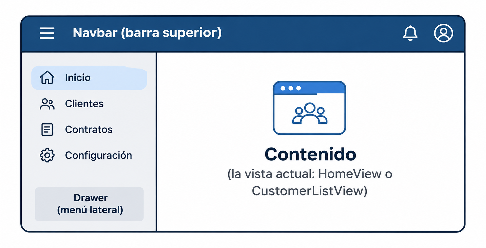
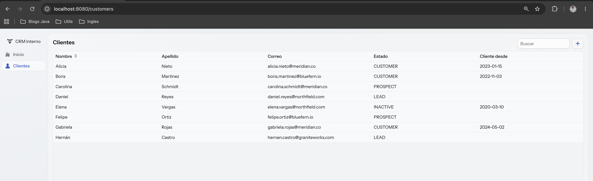

# Sesión 7: App shell y navegación

!!! info "Resumen de la sesión"
    - **Al terminar vas a tener:** un marco común para toda la app, con
      logo, nombre y un menú lateral para ir entre Inicio y Clientes.
    - **Conceptos nuevos:** `AppLayout`, `@Layout`, drawer, `SideNav` y
      `SideNavItem`, navegación type-safe.

---

## De dónde partimos

La app tiene dos vistas: `HomeView` en `/` y `CustomerListView` en
`/customers`.

## El problema

La única forma de ir de una pantalla a otra es **escribir la URL a
mano**. Ningún usuario va a hacer eso. Además, cada pantalla está
"suelta": no hay nombre de la aplicación, ni logo, ni un menú común.

---

## Concepto: el *app shell*

Un **app shell** (o *layout* principal) es el marco que envuelve todas
las pantallas: lo que **no cambia** al navegar. En Vaadin se construye
con `AppLayout`, que tiene tres zonas:



Al navegar, solo cambia la zona de contenido. El drawer y la barra se
quedan.

---

## Paso 1: Un layout vacío

Crea `src/main/java/com/baqjug/crm/ui/MainLayout.java`:

```java
package com.baqjug.crm.ui;

import com.vaadin.flow.component.applayout.AppLayout;
import com.vaadin.flow.router.Layout;

@Layout
public class MainLayout extends AppLayout {
}
```

- `extends AppLayout`: hereda las tres zonas.
- `@Layout` sin argumentos: este layout envuelve **todas** las rutas de
  la aplicación. No hay que tocar ningún `@Route` ni listar vistas.

**Guarda y mira:** apenas se recarga, aparece un marco alrededor de las
dos vistas. Todavía vacío.

## Paso 2: El menú a la izquierda

```java
public MainLayout() {
    setPrimarySection(Section.DRAWER);
}
```

`setPrimarySection` decide qué zona manda:

| Valor | Resultado |
|-------|-----------|
| `Section.NAVBAR` (por defecto) | La barra superior ocupa todo el ancho; el drawer queda debajo |
| `Section.DRAWER` | El drawer ocupa todo el alto, a la izquierda; la barra queda a su lado |

Para una herramienta interna con menú, `DRAWER` es lo habitual.

## Paso 3: El menú de navegación

```java
var nav = new SideNav();
nav.addItem(new SideNavItem("Inicio", HomeView.class, VaadinIcon.HOME.create()));

addToDrawer(nav);
```

Imports:

```java
import com.vaadin.flow.component.icon.VaadinIcon;
import com.vaadin.flow.component.sidenav.SideNav;
import com.vaadin.flow.component.sidenav.SideNavItem;
```

`SideNavItem` recibe tres cosas: el texto, **la clase de la vista** y un
ícono opcional. `addToDrawer(...)` pone el menú en el drawer.

**Guarda y mira:** aparece "Inicio" en el menú. Haz clic: lleva a `/`.

Ahora agrega Clientes:

```java
nav.addItem(new SideNavItem("Clientes", CustomerListView.class, VaadinIcon.USER.create()));
```

**Guarda y mira:** navega entre las dos. El ítem de la vista actual se
**resalta solo**: no escribimos nada para eso.

!!! abstract "Por qué la clase y no la URL"
    `SideNavItem` recibe `CustomerListView.class`, no el texto
    `"customers"`. La ruta se lee del `@Route` de esa clase. Ventajas:

    - Si mañana cambias `@Route("customers")` por `@Route("clientes")`,
      el menú sigue funcionando sin tocarlo.
    - Un error de tipeo (`CustomerListVew.class`) es un **error de
      compilación**, no un enlace roto que descubre un usuario.

## Paso 4: Logo y nombre de la app

```java
var logo = VaadinIcon.VAADIN_H.create();
var appName = new Span("CRM Interno");
var header = new HorizontalLayout(logo, appName);

addToDrawer(header, nav);
```

Imports:

```java
import com.vaadin.flow.component.html.Span;
import com.vaadin.flow.component.orderedlayout.HorizontalLayout;
```

`Span` es un texto en línea, como `<span>` en HTML. Cambia el
`addToDrawer(nav)` anterior por `addToDrawer(header, nav)`: el encabezado
va primero, arriba del menú.

**Guarda y mira:** el logo y el nombre quedan **pegados al borde**.

## Paso 5: Espacio alrededor del encabezado

```java
header.setPadding(true);
```

`VerticalLayout` trae relleno (*padding*) por defecto, pero
`HorizontalLayout` **no**. Hay que activarlo.

**Guarda y mira:** el encabezado respira.

---

## Código completo al cierre de la sesión

??? example "MainLayout.java"
    ```java
    package com.baqjug.crm.ui;

    import com.vaadin.flow.component.applayout.AppLayout;
    import com.vaadin.flow.component.html.Span;
    import com.vaadin.flow.component.icon.VaadinIcon;
    import com.vaadin.flow.component.orderedlayout.HorizontalLayout;
    import com.vaadin.flow.component.sidenav.SideNav;
    import com.vaadin.flow.component.sidenav.SideNavItem;
    import com.vaadin.flow.router.Layout;

    @Layout
    public class MainLayout extends AppLayout {

        public MainLayout() {
            setPrimarySection(Section.DRAWER);

            var logo = VaadinIcon.VAADIN_H.create();
            var appName = new Span("CRM Interno");
            var header = new HorizontalLayout(logo, appName);
            header.setPadding(true);

            var nav = new SideNav();
            nav.addItem(new SideNavItem("Inicio", HomeView.class, VaadinIcon.HOME.create()));
            nav.addItem(new SideNavItem("Clientes", CustomerListView.class, VaadinIcon.USER.create()));

            addToDrawer(header, nav);
        }
    }
    ```

`CustomerListView` y `HomeView` no cambian en esta sesión.



---

## Verifica

- [ ] Las dos vistas aparecen dentro del mismo marco.
- [ ] El menú está a la izquierda, con logo y "CRM Interno" arriba.
- [ ] Clic en "Inicio" lleva a `/`; clic en "Clientes" lleva a `/customers`.
- [ ] El ítem de la vista actual está resaltado.

??? tip "Para profundizar: el menú en pantallas angostas"
    En una ventana angosta (un celular), `AppLayout` convierte el drawer
    en un panel que se superpone al contenido. Para que el usuario pueda
    abrirlo y cerrarlo, agrega un botón de menú en la barra superior:

    ```java
    addToNavbar(new DrawerToggle());
    ```

    Import: `com.vaadin.flow.component.applayout.DrawerToggle`.

## Errores comunes

| Síntoma | Causa | Solución |
|---------|-------|----------|
| No aparece el marco | Falta `@Layout` | Agrégalo sobre la clase |
| El import de `@Layout` no compila | Importaste otra anotación `Layout` | `com.vaadin.flow.router.Layout` |
| El menú está arriba, no a la izquierda | Falta `setPrimarySection(Section.DRAWER)` | Agrégalo en el constructor |
| `SideNavItem` no encuentra `CustomerListView` | Está en otro paquete sin import | Impórtala, o deja ambas clases en `ui` |
| El encabezado queda pegado al borde | `HorizontalLayout` no trae padding | `header.setPadding(true)` |

## Qué resolvimos

- **Un marco común** para todas las pantallas con `AppLayout` y una sola
  anotación, `@Layout`.
- **Navegación sin URLs a mano**, con el ítem activo resaltado de fábrica.
- **Navegación type-safe**: el menú apunta a clases, no a textos.

## Checkpoint

```bash
git add . && git commit -m "feat: app shell with side navigation"
```

Sigue con la [Sesión 8](sesion_8.md).
