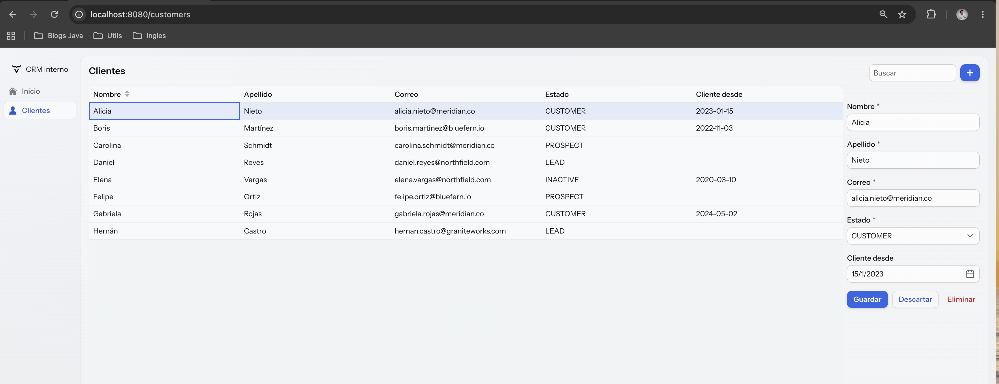
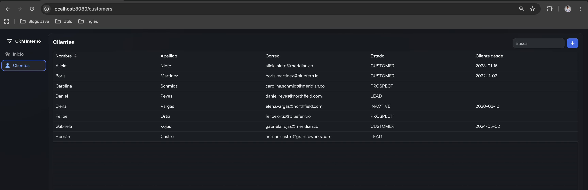
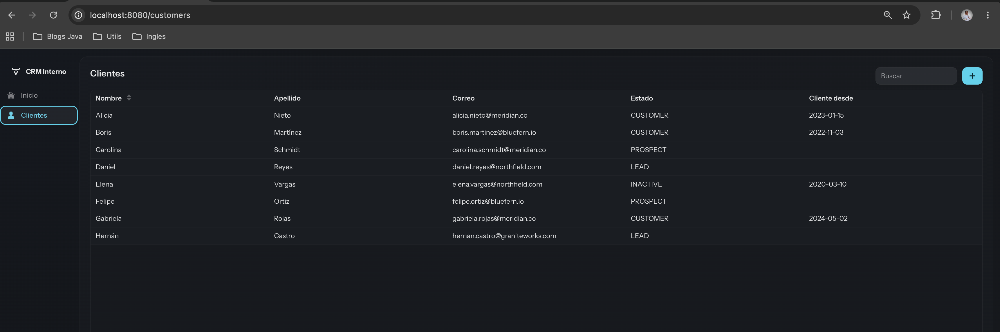

# Sesión 8: Estilos, tema Aura y cierre

!!! info "Resumen de la sesión"
    - **Tiempo en vivo:** 11 min (8 de estilos + 3 de cierre) · Video de
      referencia: 51:42
    - **Al terminar vas a tener:** botones con jerarquía visual, CSS
      propio, modo claro/oscuro y un tema con los colores de tu marca.
    - **Conceptos nuevos:** variantes de tema, `getStyle()`, clases CSS,
      `styles.css`, `@ColorScheme`, temas Aura y Lumo, variables CSS.

---

## De dónde partimos

La aplicación funciona de punta a punta: navegación, Grid, búsqueda,
formulario, alta, edición y baja contra la base de datos. Pero todos los
botones se ven iguales y la app usa los colores por defecto.

## Las tres herramientas de estilo, de menor a mayor esfuerzo

| Herramienta | Cuándo usarla | Ejemplo |
|-------------|---------------|---------|
| **Variantes de tema** | Siempre primero: el componente ya trae la opción | Botón primario, botón de error |
| **CSS propio** | No hay variante para lo que necesitas | Poner en negrita el nombre de la app |
| **Variables del tema** | Cambiar el aspecto de **toda** la app de una vez | Colores de marca |

---

## Parte 1: Variantes de tema

### El problema

Guardar, Descartar y Eliminar se ven idénticos. El usuario no distingue
la acción principal de la peligrosa.

### Paso 1: Botones primarios

En `createToolbar()`:

```java
addBtn.addThemeVariants(ButtonVariant.PRIMARY);
```

En `createForm()`:

```java
saveBtn.addThemeVariants(ButtonVariant.PRIMARY);
```

Import: `com.vaadin.flow.component.button.ButtonVariant`.

**Guarda y mira:** Guardar y + quedan con fondo de color. Son las
acciones principales de cada zona.

### Paso 2: Eliminar en rojo, sin borde

En `createForm()`:

```java
deleteBtn.addThemeVariants(ButtonVariant.ERROR, ButtonVariant.TERTIARY);
```

Las variantes se **combinan**:

| Variante | Efecto |
|----------|--------|
| `PRIMARY` | Fondo de color: la acción principal |
| `ERROR` | Color rojo: acción peligrosa |
| `TERTIARY` | Sin fondo ni borde: acción secundaria |

`ERROR` + `TERTIARY` da un Eliminar rojo y discreto: se lee como
peligroso, pero no compite con Guardar.

!!! note "Si vienes de Vaadin 24"
    Las constantes ya no llevan el prefijo del tema: es
    `ButtonVariant.PRIMARY`, no `ButtonVariant.LUMO_PRIMARY`.

### Paso 3: El botón del diálogo

En `confirmDelete()`:

```java
dialog.setConfirmButtonTheme("primary error");
```

`ConfirmDialog` crea su propio botón, así que la variante se le pasa
como texto. Ahora el botón "Eliminar" del diálogo es rojo, no azul.

### Paso 4: Un ajuste puntual de espaciado

En `createForm()`:

```java
form.getStyle().setPaddingTop("30px");
```

`getStyle()` aplica CSS **directamente** a un componente desde Java.
Sirve para casos puntuales: un solo padding no merece un archivo CSS. Si
el mismo estilo se repite en varios lugares, va en la hoja de estilos.



---

## Parte 2: CSS propio y modo claro/oscuro

### El problema

Queremos el nombre de la app en negrita, y no existe una variante para
eso. Además, la app ignora si el sistema operativo del usuario está en
modo oscuro.

### Paso 5: Una clase CSS

En `MainLayout`:

```java
appName.addClassNames("app-name");
```

En `src/main/resources/META-INF/resources/styles.css`:

```css
.app-name {
    font-weight: bold;
}
```

- `addClassNames("app-name")` le pone la clase CSS `app-name` al
  componente, igual que `class="app-name"` en HTML.
- `styles.css` ya se carga desde la Sesión 0, por el
  `@StyleSheet("styles.css")` de `Application`.

**Guarda el CSS y mira:** el cambio se ve **sin reiniciar**. Es CSS
normal, sin un lenguaje propietario.

### Paso 6: Seguir el modo del sistema operativo

En `Application`, agrega la anotación:

```java
import com.vaadin.flow.component.page.ColorScheme;

@SpringBootApplication
@StyleSheet(Aura.STYLESHEET)
@StyleSheet("styles.css")
@ColorScheme(ColorScheme.Value.LIGHT_DARK)
public class Application implements AppShellConfigurator {
```

| Valor | Resultado |
|-------|-----------|
| `LIGHT` | Siempre claro |
| `DARK` | Siempre oscuro |
| `LIGHT_DARK` | Sigue la preferencia del navegador o del sistema operativo |

!!! warning "Reinicia la aplicación"
    Los cambios en `Application.java` no se aplican con *hotswap*.

**Mira:** cambia tu sistema operativo a modo oscuro y la app lo sigue.
Fondo, texto, Grid, campos y botones: todo cambia, porque el tema ya
trae las dos versiones.

### Aura y Lumo

Vaadin incluye dos temas:

| Tema | Características |
|------|-----------------|
| **Aura** | El más reciente. Es el que usamos |
| **Lumo** | El tema clásico de Vaadin, más cuadrado |

Los dos soportan claro y oscuro. Para probar Lumo, cambia en
`Application`:

```java
import com.vaadin.flow.theme.lumo.Lumo;

@StyleSheet(Lumo.STYLESHEET)
```

y reinicia. Vuelve a `Aura.STYLESHEET` para seguir.



---

## Parte 3: Marca propia con el editor de temas de Aura

### El problema

Queremos los colores de nuestra marca. Cambiar a mano el color de cada
botón, campo, ítem de menú y fila seleccionada sería interminable.

### Concepto: variables CSS

El tema Aura no tiene colores escritos componente por componente. Todos
los componentes leen **variables CSS** compartidas, por ejemplo
`--aura-accent-color-light`. Si cambias la variable una vez, el cambio
se propaga a todos los componentes que la usan.

### Paso 7: Generar y pegar el tema

El editor de temas de Aura (ver la
[documentación de Aura](https://vaadin.com/docs/latest/styling/themes/aura))
te deja elegir en el navegador el color de acento, el tamaño de letra,
la densidad y el contraste, y exporta un bloque de variables. Pégalo en
`styles.css`, debajo de `.app-name`. Por ejemplo:

```css
html {
    --aura-accent-color-dark: #22D3EE;
    --aura-accent-color-light: #7F22FE;
    --aura-background-color-light: #FFFFFF;
    --aura-base-font-size: 13;
    --aura-base-size: 20;
    --aura-content-color-scheme: dark;
    --aura-contrast-level: 0.25;
    --aura-notification-color-scheme: dark;
    color-scheme: dark;
}

html {
    --vaadin-button-font-weight: 600;
    --vaadin-grid-header-font-weight: 600;
}
```

| Variable | Qué controla |
|----------|--------------|
| `--aura-accent-color-light` / `-dark` | Color de acento en modo claro / oscuro (botones primarios, selección, ítem activo) |
| `--aura-base-font-size` | Tamaño de letra base |
| `--aura-base-size` | Densidad: tamaño de campos y botones |
| `--aura-contrast-level` | Contraste entre superficies |
| `--vaadin-button-font-weight` | Grosor de letra de **todos** los botones |
| `--vaadin-grid-header-font-weight` | Grosor de letra de los encabezados del Grid |

Las variables `--aura-*` son del tema; las `--vaadin-*` ajustan un tipo
de componente en particular.

### Paso 8: Fijar el modo oscuro

Este tema de ejemplo está pensado para modo oscuro. En `Application`:

```java
@ColorScheme(ColorScheme.Value.DARK)
```

y reinicia.

**Mira:** no tocamos ni un componente, y botones, campos, diálogos, el
Grid y el menú cambiaron juntos. Como el modo está fijado en oscuro, se
ve el acento `--aura-accent-color-dark` (cian); el morado de
`--aura-accent-color-light` queda listo por si vuelves a modo claro.

!!! note "Contraste"
    Al elegir colores propios, verifica que el texto se siga leyendo
    bien. El [contrast checker de WebAIM](https://webaim.org/resources/contrastchecker/)
    sirve para comprobarlo.



---

## Código completo al cierre del taller

??? example "Application.java"
    ```java
    package com.baqjug.crm;

    import com.vaadin.flow.component.dependency.StyleSheet;
    import com.vaadin.flow.component.page.AppShellConfigurator;
    import com.vaadin.flow.component.page.ColorScheme;
    import com.vaadin.flow.theme.aura.Aura;
    import org.springframework.boot.SpringApplication;
    import org.springframework.boot.autoconfigure.SpringBootApplication;

    @SpringBootApplication
    @StyleSheet(Aura.STYLESHEET)
    @StyleSheet("styles.css")
    @ColorScheme(ColorScheme.Value.DARK)
    public class Application implements AppShellConfigurator {

        public static void main(String[] args) {
            SpringApplication.run(Application.class, args);
        }
    }
    ```

??? example "MainLayout.java"
    ```java
    package com.baqjug.crm.ui;

    import com.vaadin.flow.component.applayout.AppLayout;
    import com.vaadin.flow.component.html.Span;
    import com.vaadin.flow.component.icon.VaadinIcon;
    import com.vaadin.flow.component.orderedlayout.HorizontalLayout;
    import com.vaadin.flow.component.sidenav.SideNav;
    import com.vaadin.flow.component.sidenav.SideNavItem;
    import com.vaadin.flow.router.Layout;

    @Layout
    public class MainLayout extends AppLayout {

        public MainLayout() {
            setPrimarySection(Section.DRAWER);

            var logo = VaadinIcon.VAADIN_H.create();
            var appName = new Span("CRM Interno");
            appName.addClassNames("app-name");
            var header = new HorizontalLayout(logo, appName);
            header.setPadding(true);

            var nav = new SideNav();
            nav.addItem(new SideNavItem("Inicio", HomeView.class, VaadinIcon.HOME.create()));
            nav.addItem(new SideNavItem("Clientes", CustomerListView.class, VaadinIcon.USER.create()));

            addToDrawer(header, nav);
        }
    }
    ```

??? example "CustomerListView.java"
    ```java
    package com.baqjug.crm.ui;

    import com.baqjug.crm.backend.Customer;
    import com.baqjug.crm.backend.CustomerService;
    import com.baqjug.crm.backend.Status;
    import com.vaadin.flow.component.button.Button;
    import com.vaadin.flow.component.button.ButtonVariant;
    import com.vaadin.flow.component.combobox.ComboBox;
    import com.vaadin.flow.component.confirmdialog.ConfirmDialog;
    import com.vaadin.flow.component.datepicker.DatePicker;
    import com.vaadin.flow.component.formlayout.FormLayout;
    import com.vaadin.flow.component.grid.Grid;
    import com.vaadin.flow.component.html.H3;
    import com.vaadin.flow.component.icon.VaadinIcon;
    import com.vaadin.flow.component.orderedlayout.HorizontalLayout;
    import com.vaadin.flow.component.orderedlayout.VerticalLayout;
    import com.vaadin.flow.component.textfield.EmailField;
    import com.vaadin.flow.component.textfield.TextField;
    import com.vaadin.flow.data.binder.Binder;
    import com.vaadin.flow.data.binder.ValidationException;
    import com.vaadin.flow.data.value.ValueChangeMode;
    import com.vaadin.flow.router.Route;
    import com.vaadin.flow.signals.Signal;
    import com.vaadin.flow.signals.local.ValueSignal;
    import java.util.ArrayList;
    import java.util.stream.Collectors;

    @Route("customers")
    public class CustomerListView extends VerticalLayout {

        private final CustomerService customerService;

        private final Grid<Customer> grid = new Grid<>();
        private final ValueSignal<String> searchValue = new ValueSignal<>("");
        private final ValueSignal<Customer> editedCustomer = new ValueSignal<>(null);
        private final Binder<Customer> binder = new Binder<>();

        public CustomerListView(CustomerService customerService) {
            this.customerService = customerService;

            setSizeFull();
            var toolbar = createToolbar();
            configureGrid();
            var form = createForm();

            var content = new HorizontalLayout(grid, form);
            content.setSizeFull();

            add(toolbar, content);
        }

        private HorizontalLayout createToolbar() {
            var title = new H3("Clientes");

            var search = new TextField();
            search.setPlaceholder("Buscar");
            search.setValueChangeMode(ValueChangeMode.LAZY);
            search.bindValue(searchValue, searchValue::set);
            Signal.effect(search, () -> updateCustomerList(searchValue.get()));

            var addBtn = new Button(VaadinIcon.PLUS.create());
            addBtn.addThemeVariants(ButtonVariant.PRIMARY);
            addBtn.addClickListener(e -> addCustomer());

            var toolbar = new HorizontalLayout(title, search, addBtn);
            toolbar.setWidthFull();
            toolbar.setFlexGrow(1, title);
            return toolbar;
        }

        private void configureGrid() {
            grid.addColumn(Customer::getFirstName).setHeader("Nombre").setSortable(true);
            grid.addColumn(Customer::getLastName).setHeader("Apellido").setSortable(true);
            grid.addColumn(Customer::getEmail).setHeader("Correo").setSortable(true);
            grid.addColumn(Customer::getStatus).setHeader("Estado").setSortable(true);
            grid.addColumn(Customer::getCustomerSince).setHeader("Cliente desde").setSortable(true);
            grid.setSizeFull();
            grid.asSingleSelect().bindValue(editedCustomer, editedCustomer::set);
        }

        private FormLayout createForm() {
            var firstName = new TextField("Nombre");
            var lastName = new TextField("Apellido");
            var email = new EmailField("Correo");
            var status = new ComboBox<Status>("Estado");
            status.setItems(Status.values());
            var customerSince = new DatePicker("Cliente desde");

            binder.forField(firstName)
                    .asRequired("El nombre es obligatorio")
                    .bind(Customer::getFirstName, Customer::setFirstName);
            binder.forField(lastName)
                    .asRequired("El apellido es obligatorio")
                    .bind(Customer::getLastName, Customer::setLastName);
            binder.forField(email)
                    .asRequired("El correo es obligatorio")
                    .bind(Customer::getEmail, Customer::setEmail);
            binder.forField(status)
                    .asRequired("Selecciona un estado")
                    .bind(Customer::getStatus, Customer::setStatus);
            binder.bind(customerSince, Customer::getCustomerSince, Customer::setCustomerSince);

            var saveBtn = new Button();
            saveBtn.addThemeVariants(ButtonVariant.PRIMARY);
            saveBtn.bindText(editedCustomer.map(customer -> isNew(customer) ? "Crear" : "Guardar"));
            saveBtn.addClickListener(e -> save());

            var discardBtn = new Button("Descartar");
            discardBtn.addClickListener(e -> binder.readBean(editedCustomer.peek()));

            var deleteBtn = new Button("Eliminar");
            deleteBtn.addThemeVariants(ButtonVariant.ERROR, ButtonVariant.TERTIARY);
            deleteBtn.addClickListener(e -> confirmDelete());
            deleteBtn.bindEnabled(editedCustomer.map(customer -> !isNew(customer)));

            var buttons = new HorizontalLayout(saveBtn, discardBtn, deleteBtn);

            var form = new FormLayout(firstName, lastName, email, status, customerSince, buttons);
            form.setWidth("300px");
            form.getStyle().setPaddingTop("30px");
            form.bindVisible(editedCustomer.map(customer -> customer != null));
            Signal.effect(form, () -> binder.readBean(editedCustomer.get()));
            return form;
        }

        private boolean isNew(Customer customer) {
            return customer != null && customer.getId() == null;
        }

        private void addCustomer() {
            editedCustomer.set(new Customer());
        }

        private void save() {
            try {
                var customer = editedCustomer.peek();
                binder.writeBean(customer);
                customerService.save(customer);
                updateCustomerList();
            } catch (ValidationException ex) {
                // The fields already show their own error messages.
            }
        }

        private void confirmDelete() {
            var customer = editedCustomer.peek();

            var dialog = new ConfirmDialog();
            dialog.setHeader("Eliminar cliente");
            dialog.setText("¿Seguro que quieres eliminar a %s %s?"
                    .formatted(customer.getFirstName(), customer.getLastName()));
            dialog.setCancelable(true);
            dialog.setConfirmText("Eliminar");
            dialog.setConfirmButtonTheme("primary error");
            dialog.addConfirmListener(e -> {
                customerService.delete(customer);
                updateCustomerList();
            });
            dialog.open();
        }

        private void updateCustomerList() {
            updateCustomerList(searchValue.peek());
        }

        private void updateCustomerList(String query) {
            var filtered = customerService.findAll();

            if (!query.isEmpty()) {
                var lower = query.toLowerCase();
                filtered = filtered.stream()
                        .filter(c -> c.getFirstName().toLowerCase().contains(lower)
                                || c.getLastName().toLowerCase().contains(lower)
                                || c.getEmail().toLowerCase().contains(lower)
                                || c.getStatus().name().toLowerCase().contains(lower))
                        .collect(Collectors.toCollection(ArrayList::new));
            }

            grid.setItems(filtered);
        }
    }
    ```

??? example "styles.css"
    ```css
    .app-name {
        font-weight: bold;
    }

    html {
        --aura-accent-color-dark: #22D3EE;
        --aura-accent-color-light: #7F22FE;
        --aura-background-color-light: #FFFFFF;
        --aura-base-font-size: 13;
        --aura-base-size: 20;
        --aura-content-color-scheme: dark;
        --aura-contrast-level: 0.25;
        --aura-notification-color-scheme: dark;
        color-scheme: dark;
    }

    html {
        --vaadin-button-font-weight: 600;
        --vaadin-grid-header-font-weight: 600;
    }
    ```

---

## Verifica

- [ ] Guardar y + tienen fondo de color; Eliminar es rojo y sin borde.
- [ ] El botón Eliminar del diálogo es rojo.
- [ ] Hay espacio arriba del formulario.
- [ ] "CRM Interno" está en negrita.
- [ ] La app está en modo oscuro con el acento cian en botones, selección e ítem activo del menú.

## Errores comunes

| Síntoma | Causa | Solución |
|---------|-------|----------|
| `ButtonVariant.LUMO_PRIMARY` no compila | Código de Vaadin 24 | Usa `ButtonVariant.PRIMARY` |
| El CSS no se aplica y no hay error | `styles.css` está en otra carpeta | `src/main/resources/META-INF/resources/styles.css` |
| `@ColorScheme` no tiene efecto | No reiniciaste | Reinicia después de tocar `Application` |
| La app se ve sin estilos | Se borró `@StyleSheet(Aura.STYLESHEET)` | Vuelve a agregarlo en `Application` |
| Las variables no cambian nada | Escribiste `--lumo-*` con el tema Aura activo | Usa las variables `--aura-*` |

## Qué resolvimos

- **Variantes antes que CSS**: la mayoría de los componentes ya trae las
  opciones visuales que necesitas.
- **CSS normal** cuando no hay variante: clases y selectores, sin un
  lenguaje propietario.
- **Claro, oscuro o automático** con una anotación.
- **Una marca completa cambiando variables**, sin tocar un solo
  componente.

## Checkpoint

```bash
git add . && git commit -m "style: theme variants, custom css and aura branding"
```

---

## Cierre (3 min)

Construimos un CRM con:

- Grid ordenable y filtrable con Signals,
- formulario validado con Binder, en modo buffered,
- alta, edición y baja contra una base de datos real,
- navegación con un app shell,
- y un tema con colores de marca.

Todo en Java, en tres clases de interfaz (`HomeView`,
`CustomerListView`, `MainLayout`), sin HTML, sin un proyecto de
JavaScript y sin una API REST.

### Para seguir aprendiendo

- **[Directorio de add-ons](https://vaadin.com/directory)**: componentes
  de la comunidad y oficiales (calendarios, gráficos, editores). Se
  instalan copiando una dependencia Maven al `pom.xml`.
- **Vaadin Copilot**: con la app en modo desarrollo, permite editar la
  interfaz desde el navegador, de forma visual o escribiendo lo que
  quieres cambiar, y escribe el cambio en tu código Java.
- **[Signals](https://vaadin.com/docs/latest/flow/ui-state)**: hoy usamos
  `ValueSignal`, `map` y `Signal.effect`. Hay más tipos, como
  `ListSignal` y los signals computados.
- **El tutorial en inglés** en el que se basa este taller:
  [texto](https://drewharvey.github.io/vaadin-intro-tutorial/) y
  [código](https://github.com/drewharvey/vaadin-intro-tutorial).


